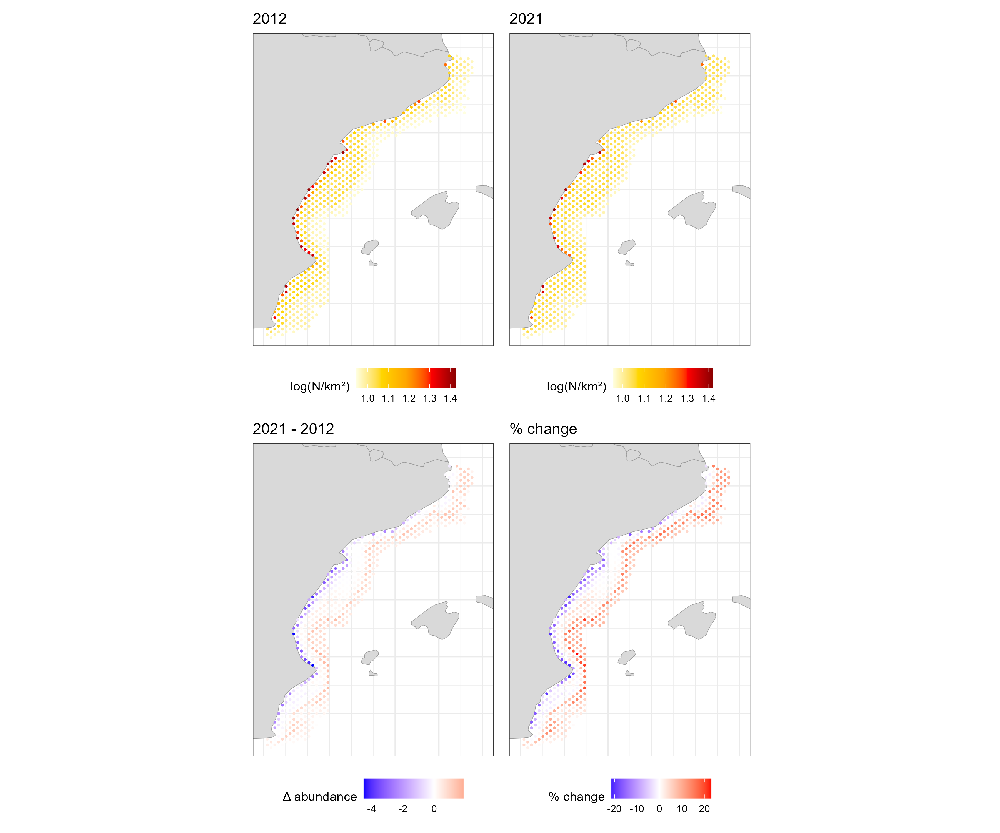

```{=html}
<style>
.tbl-compact table { width: auto !important; margin: 0.5rem auto 1rem; font-size: 0.82rem; }
.tbl-compact th, .tbl-compact td { padding: 0.3rem 0.6rem !important; white-space: nowrap; }
blockquote { border-left: 4px solid #e4b363; background: #fdf6e8; margin: 1rem 0; padding: 0.6rem 1rem; }
</style>
```

```{r setup}
#| echo: false
#| cache: false

library(dplyr)
library(tidyr)
library(ggplot2)
library(patchwork)
library(mgcv)
library(MuMIn)
library(knitr)
library(scales)

pal_ocean <- c(deep = "#062d4a", mid = "#0d4f7a", surface = "#1a7fa8",
               light = "#4eb8d4", foam = "#c8eaf4", accent = "#12726B",
               alert = "#c0392b", sand = "#e4b363", grey = "#b0b7bf")

theme_ocean <- function(base_size = 11) {
  theme_minimal(base_size = base_size) +
    theme(panel.grid.minor = element_blank(),
          plot.title = element_text(face = "bold", colour = pal_ocean[["deep"]]),
          plot.title.position = "plot",
          legend.position = "bottom",
          axis.title = element_text(colour = "grey30"))
}

world <- map_data("world")
land  <- geom_polygon(data = world, aes(long, lat, group = group),
                      fill = "grey88", colour = "grey65", linewidth = 0.2)
gsa6_view <- coord_fixed(1.3, xlim = c(-1, 4), ylim = c(37.5, 42.5))
med_view  <- coord_fixed(1.3, xlim = c(-5, 35), ylim = c(34.7, 45.4))
theme_map <- theme_ocean() +
  theme(axis.title = element_blank(), axis.text = element_blank(),
        axis.ticks = element_blank(), panel.grid = element_blank())

fmt <- function(x, acc = 1) comma(x, accuracy = acc)
```

## Overview

This report brings together the four exercises of the working group into one reproducible document. The question running through all of them is how climate and environmental conditions relate to the distribution of demersal fish and to the behaviour of the trawl fleet, as seen through AIS.

| Step | Script | Question | Main output |
|---|---|---|---|
| 1 | `scripts/1_data exploration.R` | What do the survey, environmental and AIS data look like, and how do they join? | `data/processed/MEDITS_and_environment.csv` |
| 2a | `scripts/2_SDMs.R` | How does total fish abundance relate to the environment, and how has habitat suitability changed 2012-2021? | `outputs/Final_gam_prediction.csv`, `outputs/fish.change6.csv` |
| 2b | Section 2b of this report | The same question for red mullet (*Mullus barbatus*), the group's focal species | `outputs/MULLBAR_gam_prediction_GSA6.csv`, `outputs/MULLBAR_change_GSA6.csv` |
| 3 | `scripts/3_MHW.R` | Where and when do marine heatwaves occur, and does trawling differ in heatwave summers? | `outputs/MHW_gsa6.csv`, `outputs/fishing_change_MHW.csv` |
| 4 | `scripts/4_Vulnerability Index.R` | Which areas combine heatwave exposure, habitat loss and fishing pressure? | `outputs/CFVI_GSA6.csv` |

Steps the group already ran that call the Global Fishing Watch API, read the large prediction grid or need the daily SST NetCDF are shown but not re-run (marked *not evaluated*). Their saved outputs are loaded instead. Everything else runs when the report is rendered, including the red mullet model of Section 2b, which is new.

The study area is **GSA 6 (northern Spain)**, the GFCM Geographical Sub-Area covering the Spanish Mediterranean coast from Murcia to the French border, and the fleet is restricted to **trawlers**, the gear sampled by MEDITS.

## 1. Data preparation

### Data sources

- **MEDITS** (Mediterranean International Trawl Survey), 2012-2021, from the JRC data portal: abundance (N/km²) and biomass (kg/km²) per species and haul. MEDITS is a standardised bottom-trawl survey run every year, mostly in late spring and early summer.
- **Environmental variables** at each haul, from the Copernicus Marine Mediterranean physics (MEDSEA_MULTIYEAR_PHY_006_004) and biogeochemistry (MEDSEA_MULTIYEAR_BGC_006_008) reanalyses: sea surface and bottom temperature (`sst`, `botTemp`), surface and bottom salinity (`so`, `botso`), chlorophyll (`chl`) and primary production (`nppv`), plus substrate and depth.
- **AIS apparent fishing hours** from Global Fishing Watch, trawlers only, yearly, 0.1° cells, GFCM area, pulled with `gfwr::gfw_ais_fishing_hours()`.

```{r step1-download}
#| eval: false
#| code-summary: "Load MEDITS and pull yearly trawler effort with gfwr (not evaluated)"

library(gfwr)
key <- gfw_auth()

medits <- read.csv("data/raw/MEDITS_2012_2021.csv")
env    <- read.csv("data/raw/MED.env_haul_2012_2021.csv")
years  <- sort(unique(env$YEAR))

yearly_fishing_hrs <- purrr::map_dfr(years, function(yr) {
  gfw_ais_fishing_hours(
    spatial_resolution  = "LOW",            # 0.1 degree
    temporal_resolution = "YEARLY",
    start_date = paste0(yr, "-01-01"),
    end_date   = paste0(yr + 1, "-01-01"),  # end date excluded
    region_source = "RFMO", region = "GFCM",
    key = key)
}) |>
  filter(`Gear Type` == "TRAWLERS") |>
  group_by(year = `Time Range`, Lat, Lon) |>
  summarise(fishing_hours = sum(`Apparent Fishing Hours`, na.rm = TRUE),
            .groups = "drop")
```

Hauls and GFW cells are joined on year and coordinates rounded to the grid resolution.

```{r step1-join}
#| eval: false
#| code-summary: "Join effort to hauls and merge everything (not evaluated)"

match_gfw_grid_data <- function(target_df, source_df, key_col = "year",
                                value_col = "fishing_hours",
                                target_coords = c("X", "Y"),
                                source_coords = c("Lon", "Lat"), res = 0.1) {
  digits <- -floor(log10(res))
  target_prep <- target_df |>
    mutate(.grid_lon = round(.data[[target_coords[1]]], digits),
           .grid_lat = round(.data[[target_coords[2]]], digits))
  source_prep <- source_df |>
    filter(.data[[key_col]] %in% unique(target_df[[key_col]])) |>
    mutate(.grid_lon = round(.data[[source_coords[1]]], digits),
           .grid_lat = round(.data[[source_coords[2]]], digits)) |>
    select(all_of(c(key_col, ".grid_lon", ".grid_lat", value_col)))
  target_prep |>
    left_join(source_prep, by = c(key_col, ".grid_lon", ".grid_lat")) |>
    select(-.grid_lon, -.grid_lat)
}

env_with_fishing <- match_gfw_grid_data(env |> rename(year = YEAR),
                                        yearly_fishing_hrs) |>
  select(ids, sst, botTemp, so, botso, chl, fishing_hours)

medits_env <- medits |>
  select(-c(SHOOTING_LATITUDE, SHOOTING_LONGITUDE, HAULING_LATITUDE,
            HAULING_LONGITUDE, HAUL_DURATION, DISTANCE, WING_OPENING,
            GENUS, SPECIES)) |>
  left_join(env_with_fishing, by = c("id" = "ids"))

write.csv(medits_env, "data/processed/MEDITS_and_environment.csv", row.names = FALSE)
```

> **Discussion point: grid alignment.** GFW returns the lower-left corner of each cell, while the haul coordinates are rounded to the *nearest* 0.1°. Roughly half the hauls are therefore matched to a neighbouring cell. Flooring the haul coordinates (`floor(x * 10) / 10`) would align the two.

### The merged dataset

```{r step1-load}
#| code-summary: "Load the merged survey, environment and effort table"

med <- read.csv("data/processed/MEDITS_and_environment.csv")
hauls <- distinct(med, id, .keep_all = TRUE)
```

The merged table holds `r fmt(nrow(med))` species-by-haul records from `r fmt(nrow(hauls))` hauls across `r n_distinct(hauls$GSA)` GSAs.

```{r fig-hauls}
#| fig-cap: "MEDITS hauls 2012-2021, coloured by GSA (left), and number of hauls per year (right)."
#| fig-width: 11
#| fig-height: 4.5

p_map <- ggplot(hauls) + land +
  geom_point(aes(MEAN_LONGITUDE_DEC, MEAN_LATITUDE_DEC, colour = factor(GSA)),
             size = 0.5, alpha = 0.7) +
  med_view + theme_map + theme(legend.position = "none") +
  labs(title = "Survey hauls")

p_year <- hauls |> count(GSA, YEAR) |>
  ggplot(aes(YEAR, n, fill = factor(GSA))) + geom_col() +
  scale_x_continuous(breaks = 2012:2021) +
  theme_ocean() + theme(legend.position = "right") +
  labs(title = "Hauls per year", x = NULL, y = "Hauls", fill = "GSA")

p_map + p_year + plot_layout(widths = c(1.5, 1))
```

```{r fig-sst}
#| fig-cap: "Sea surface temperature at the time of each haul."
#| fig-width: 11
#| fig-height: 6

ggplot(hauls) + land +
  geom_point(aes(MEAN_LONGITUDE_DEC, MEAN_LATITUDE_DEC, colour = sst), size = 0.4) +
  scale_colour_viridis_c(name = "SST (°C)") +
  med_view + facet_wrap(~YEAR, ncol = 5) + theme_map
```

### What AIS sees over time

Before using AIS effort as a covariate, it is worth checking how its coverage changes over the study period.

```{r fig-ais-ramp}
#| fig-cap: "Share of MEDITS hauls with matched AIS trawler effort, and mean effort at matched hauls, by year. The 2012-2014 increase reflects AIS adoption by the fleet rather than more fishing."
#| fig-width: 10
#| fig-height: 4

ais_cov <- hauls |>
  group_by(YEAR) |>
  summarise(matched = mean(!is.na(fishing_hours)),
            mean_hours = mean(fishing_hours, na.rm = TRUE), .groups = "drop")

(ggplot(ais_cov, aes(YEAR, matched)) +
   geom_col(fill = pal_ocean[["surface"]]) +
   scale_y_continuous(labels = percent) +
   labs(title = "Hauls with AIS effort", x = NULL, y = NULL)) +
(ggplot(ais_cov, aes(YEAR, mean_hours)) +
   geom_line(colour = pal_ocean[["deep"]]) +
   geom_point(colour = pal_ocean[["deep"]]) +
   labs(title = "Mean trawler hours per matched haul cell", x = NULL, y = NULL)) &
  scale_x_continuous(breaks = 2012:2021) & theme_ocean()
```

In 2012, only `r percent(ais_cov$matched[ais_cov$YEAR == 2012], 1)` of hauls fall in a cell with any AIS trawler effort, against `r percent(ais_cov$matched[ais_cov$YEAR == 2021], 1)` in 2021. Mean effort at matched hauls rises from `r fmt(ais_cov$mean_hours[ais_cov$YEAR == 2012])` hours in 2012 to `r fmt(ais_cov$mean_hours[ais_cov$YEAR == 2015])` in 2015, then stabilises.

> **Discussion point: AIS ramp-up.** Trawler AIS coverage at MEDITS hauls grows sharply over 2012-2014. Any comparison across these years (habitat change in Step 2, heatwave vs non-heatwave summers in Step 3) partly measures AIS uptake. Options: start in 2015, use effort per vessel, or treat early years separately.

## 2a. Species distribution model: total fish abundance

### Response variable

Species distribution models (SDMs) relate biological observations to environmental conditions to estimate habitat suitability and predict into unsampled locations. Here the response is **total fish abundance** per haul (N/km², all MEDITS faunistic categories A, Aa, Ae, Ao), modelled within a single GSA so that species-habitat relationships are reasonably homogeneous.

```{r step2-response}
#| code-summary: "Aggregate fish abundance per haul, keep GSA 6"

spp.list <- read.csv("data/raw/MEDITS_listTM.csv", sep = ";")

fish <- med |>
  left_join(select(spp.list, MEDITS.Code, CATFAU),
            by = c("MEDITS_CODE" = "MEDITS.Code")) |>
  filter(CATFAU %in% c("A", "Aa", "Ae", "Ao")) |>
  group_by(id) |>
  summarise(across(-c(MEDITS_CODE, CATFAU, N_h, N_km2, kg_h, kg_km2), first),
            N_km2 = sum(N_km2, na.rm = TRUE), .groups = "drop") |>
  as.data.frame()

fish6 <- filter(fish, GSA == 6)
fish6$log_N_km2 <- log(fish6$N_km2)
```

```{r fig-response}
#| fig-cap: "Distribution of total fish abundance in GSA 6 hauls, raw and log-transformed."
#| fig-width: 9
#| fig-height: 3.5

(ggplot(fish6, aes(N_km2)) + geom_histogram(bins = 40, fill = pal_ocean[["mid"]]) +
   scale_x_continuous(labels = label_comma()) + labs(x = "N/km²", y = "Hauls")) +
(ggplot(fish6, aes(log_N_km2)) + geom_histogram(bins = 40, fill = pal_ocean[["accent"]]) +
   labs(x = "log(N/km²)", y = NULL)) & theme_ocean()
```

GSA 6 contributes `r fmt(nrow(fish6))` hauls. Abundance is strongly right-skewed, so it is modelled on the log scale.

### Collinearity

```{r fig-cor}
#| fig-cap: "Pairwise Pearson correlations among candidate predictors in GSA 6 hauls. Variables are ordered by hierarchical clustering so that correlated groups sit together; pairs with |r| above 0.6 are outlined."
#| fig-width: 7.5
#| fig-height: 6.5

# Readable names for predictors
var_labels <- c(sst = "Surface temperature", botTemp = "Bottom temperature",
                so = "Surface salinity", botso = "Bottom salinity",
                chl = "Chlorophyll", MEAN_DEPTH = "Depth", depth = "Depth",
                fishing_hours = "Trawling effort (AIS)")

# Lower-triangle correlation heatmap, clustered, with |r| > threshold outlined
cor_heatmap <- function(df, threshold = 0.6) {
  m <- cor(df, use = "pairwise.complete.obs")
  ord <- hclust(as.dist(1 - abs(m)))$order
  m <- m[ord, ord]
  labs <- unname(var_labels[colnames(m)])
  dimnames(m) <- list(labs, labs)

  d <- as.data.frame(as.table(m)) |>
    setNames(c("x", "y", "r")) |>
    mutate(i = as.integer(x), j = as.integer(y)) |>
    filter(i < j) |>
    mutate(x = factor(x, labs), y = factor(y, rev(labs)),
           strong = abs(r) > threshold,
           txt = ifelse(abs(r) > 0.45, "white", pal_ocean[["deep"]]))

  ggplot(d, aes(x, y)) +
    geom_tile(aes(fill = r), colour = "white", linewidth = 1.6) +
    geom_tile(data = filter(d, strong), fill = NA, colour = pal_ocean[["deep"]],
              linewidth = 0.9, width = 0.9, height = 0.9) +
    geom_text(aes(label = sprintf("%.2f", r), colour = txt), size = 3.8,
              fontface = "bold", family = "sans") +
    scale_colour_identity() +
    scale_fill_gradientn(
      colours = c("#8c2d1f", "#d9785f", "#f3d6c8", "#f7f7f5", "#c8eaf4", "#4eb8d4", "#0d4f7a"),
      values = scales::rescale(c(-1, -0.6, -0.25, 0, 0.25, 0.6, 1)),
      limits = c(-1, 1), breaks = c(-1, -0.5, 0, 0.5, 1),
      name = "Pearson r") +
    scale_x_discrete(position = "top", drop = TRUE) +
    scale_y_discrete(drop = TRUE) +
    coord_fixed() +
    guides(fill = guide_colourbar(barwidth = unit(14, "lines"), barheight = unit(0.6, "lines"),
                                  title.position = "top", title.hjust = 0.5,
                                  ticks.colour = "white", frame.colour = NA)) +
    theme_minimal(base_size = 12) +
    theme(axis.title = element_blank(),
          axis.text.x.top = element_text(angle = 35, hjust = 0, vjust = 0,
                                         colour = pal_ocean[["deep"]]),
          axis.text.y = element_text(colour = pal_ocean[["deep"]]),
          panel.grid = element_blank(),
          legend.position = "bottom",
          legend.title = element_text(colour = "grey30", size = 10),
          plot.margin = margin(10, 30, 10, 10))
}

vars <- select(fish6, sst, botTemp, so, botso, chl, MEAN_DEPTH, fishing_hours)
cor.mat <- cor(vars, use = "pairwise.complete.obs")
cor_heatmap(vars)
```

The group's script uses `usdm::vif()` and `vifstep(th = 3)`. The same variance inflation factors are computed below from auxiliary regressions.

```{r step2-vif}
#| code-summary: "Variance inflation factors"
#| classes: tbl-compact

vif_manual <- function(df) {
  df <- na.omit(df)
  sapply(names(df), function(v) {
    r2 <- summary(lm(reformulate(setdiff(names(df), v), v), data = df))$r.squared
    1 / (1 - r2)
  })
}
vif_tab <- tibble(variable = names(vars), VIF = round(vif_manual(vars), 2))
kable(vif_tab)
```

Collinearity is moderate overall. Bottom salinity (`botso`) is the only variable above the VIF threshold of 3, driven by its correlation with depth (r = 0.79) and bottom temperature (r = -0.63), and is dropped. Depth (VIF just under 3) is left out of the candidate set, its information being largely carried by bottom temperature.

### GAM fitting and selection

Generalised additive models (GAMs, `mgcv`) allow smooth, non-linear responses. Smooths are capped at `k = 4` to keep response curves ecologically interpretable, and `select = TRUE` adds a shrinkage penalty so that unhelpful terms can be shrunk to zero. Hauls with any missing predictor are removed.

```{r step2-gam}
#| code-summary: "Fit the full and reduced GAMs"

fish6 <- na.omit(fish6)

gam1 <- gam(log_N_km2 ~ s(sst, k = 4) + s(botTemp, k = 4) + s(so, k = 4) +
              s(chl, k = 4) + s(fishing_hours, k = 4),
            family = gaussian, data = fish6, method = "REML", select = TRUE)

gam2 <- gam(log_N_km2 ~ s(botTemp, k = 4) + s(so, k = 4) + s(chl, k = 4) +
              s(fishing_hours, k = 4),
            family = gaussian, data = fish6, method = "REML", select = TRUE)

gam_tab <- tibble(
  model = c("gam1: full", "gam2: without SST"),
  n = c(nobs(gam1), nobs(gam2)),
  `R² (adj.)` = round(c(summary(gam1)$r.sq, summary(gam2)$r.sq), 3),
  `Deviance explained` = percent(c(summary(gam1)$dev.expl, summary(gam2)$dev.expl), 0.1),
  AIC = round(c(AIC(gam1), AIC(gam2)), 1))
```

```{r tbl-gam}
#| echo: false
#| classes: tbl-compact
kable(gam_tab)
```

```{r tbl-smooths}
#| code-summary: "Smooth terms of the retained model (gam2)"
#| classes: tbl-compact

s_tab <- as.data.frame(summary(gam2)$s.table)
kable(tibble(term = rownames(s_tab), edf = round(s_tab$edf, 2),
             F = round(s_tab$F, 2),
             `p-value` = format.pval(s_tab$`p-value`, digits = 2, eps = 1e-4)))
```

```{r step2-dredge}
#| code-summary: "All-subsets selection on gam1 with MuMIn::dredge"
#| classes: tbl-compact

options(na.action = "na.fail")
all.models <- dredge(gam1, rank = "AICc")
options(na.action = "na.omit")

top <- as.data.frame(head(all.models, 6))
kable(top |>
        mutate(across(where(is.numeric), \(x) round(x, 2))) |>
        mutate(across(starts_with("s("), \(x) ifelse(is.na(x), "", "+"))) |>
        select(-any_of("(Intercept)")))
```

```{r fig-smooths}
#| fig-cap: "Partial effects of the retained model (gam2), with partial residuals."
#| fig-width: 9
#| fig-height: 7

plot(gam2, residuals = TRUE, pch = 16, cex = 0.2, pages = 1, shade = TRUE,
     shade.col = pal_ocean[["foam"]], col = pal_ocean[["deep"]])
```

The two GAMs are identical in fit: with `select = TRUE`, the SST smooth in `gam1` is already shrunk to zero, so removing it changes nothing. The group retained `gam2` (bottom temperature, salinity, chlorophyll, fishing hours). Bottom temperature carries most of the signal. Fishing hours is in the lowest-AICc model, but its smooth is only marginally significant (p ≈ 0.06) and models without it are within 2 AICc units. The model explains about a fifth of the deviance in log abundance, which is typical for haul-level survey data but a reminder that much of the variation is unexplained.

```{r step2-check}
#| code-summary: "Residual checks"
#| fig-width: 9
#| fig-height: 7
#| results: hide

par(mfrow = c(2, 2))
gam.check(gam2, pch = 16, cex = 0.4)
```

> **Discussion point: zeros in effort.** Hauls without matched AIS effort have `fishing_hours = NA` and are removed by `na.omit()`, so the model is fitted only on fished cells. On the prediction grid, missing effort is set to 0, outside the fitted range. Treating unmatched hauls as zero effort in both places, or adding a fished / not fished indicator, would make the two consistent.

### Prediction and habitat change

The fitted model is projected over the Copernicus hindcast grid for July of each year.

```{r step2-predict}
#| eval: false
#| code-summary: "Predict on the hindcast grid (not evaluated: 266 MB input)"

new.env <- read.csv("data/raw/MED.env_grid_hindcast_2012_2021.csv") |>
  drop_na(GSA, sst, botTemp, so, botso, chl) |>
  mutate(fishing_hours = replace_na(fishing_hours, 0))
new.env6 <- filter(new.env, GSA == 6, MONTH == 7)

gam.pred <- predict.gam(gam2, new.env6, se.fit = TRUE, type = "response")
fish.pred6 <- new.env6 |>
  mutate(fit = gam.pred$fit, se.fit = gam.pred$se.fit,
         lwr = fit - 1.96 * se.fit, upr = fit + 1.96 * se.fit)
write.table(fish.pred6, "outputs/Final_gam_prediction.csv", sep = ";", row.names = FALSE)

fish.change6 <- fish.pred6 |>
  filter(year %in% c(2012, 2021)) |>
  select(grid.id, grid.X, grid.Y, year, fit) |>
  pivot_wider(names_from = year, values_from = fit, names_prefix = "fit_") |>
  mutate(difference  = fit_2021 - fit_2012,
         perc.change = 100 * (fit_2021 - fit_2012) / fit_2012)
write.csv(fish.change6, "outputs/fish.change6.csv", row.names = FALSE)
```

```{r fig-pred}
#| fig-cap: "Predicted July fish abundance (log N/km²) in GSA 6, 2012-2021."
#| fig-width: 11
#| fig-height: 6

fish.pred6 <- read.csv("outputs/Final_gam_prediction.csv", sep = ";")

ggplot(fish.pred6) + land +
  geom_point(aes(grid.X, grid.Y, colour = fit), size = 0.45) +
  scale_colour_gradientn(colours = c("lightyellow", "gold", "orange", "red", "darkred"),
                         name = "log(N/km²)") +
  gsa6_view + facet_wrap(~year, ncol = 5) + theme_map
```

```{r fig-habitat-change}
#| fig-cap: "Group output: predicted abundance in 2012 and 2021, absolute difference and percentage change."
#| out-width: "90%"


```

> **Discussion point: log scale.** The model is fitted on log abundance, so `fit` is already log(N/km²). In the figure above, the 2012 and 2021 panels apply `log10(fit + 1)` on top, and `perc.change` is a percentage change of log values. Back-transforming before comparing gives the change in abundance itself, shown below.

```{r fig-backtransform}
#| fig-cap: "Percentage change in predicted abundance 2012-2021 computed on the log scale (as in the group output) and after back-transformation."
#| fig-width: 9
#| fig-height: 4

fish.change6 <- read.csv("outputs/fish.change6.csv") |>
  mutate(perc.change.bt = 100 * (exp(difference) - 1))

fish.change6 |>
  select(`Log scale (group output)` = perc.change,
         `Back-transformed` = perc.change.bt) |>
  pivot_longer(everything()) |>
  ggplot(aes(value, fill = name)) +
  geom_histogram(bins = 50, alpha = 0.75, position = "identity") +
  scale_fill_manual(values = c(pal_ocean[["accent"]], pal_ocean[["sand"]]), name = NULL) +
  labs(x = "% change 2012 to 2021", y = "Grid cells") + theme_ocean()
```

On the abundance scale, the median cell changes by `r percent(median(fish.change6$perc.change.bt, na.rm = TRUE) / 100, 1)` between 2012 and 2021, against `r percent(median(fish.change6$perc.change, na.rm = TRUE) / 100, 1)` on the log scale, with some cells more than tripling. Changes this large over a decade are unlikely to be purely environmental: the 2012 predictions use near-zero AIS effort (Step 1), so part of the contrast comes from the fishing-hours smooth.

## 2b. Species distribution model: red mullet

The group has since chosen to focus on **red mullet** (*Mullus barbatus*, MEDITS code `MULLBAR`), a key commercial target of the GSA 6 bottom-trawl fleet. This section repeats the SDM workflow of Section 2a for that species, with three changes that follow from the discussion points above:

- **Absences are added back.** MEDITS only lists species that were caught, so hauls without red mullet are filled in as zero abundance.
- **A Tweedie GAM replaces the Gaussian model on log abundance.** The Tweedie distribution handles exact zeros and skewed positive values in one model, and predictions come out directly as N/km², so no back-transformation is needed.
- **Depth is added as a candidate predictor**, since red mullet is mainly a continental-shelf species, and hauls without matched AIS effort are set to zero effort in both fitting and prediction.

### Response variable

```{r mb-data}
#| code-summary: "Build the red mullet haul table for GSA 6, with zeros"

hauls6 <- med |>
  filter(GSA == 6) |>
  distinct(id, .keep_all = TRUE) |>
  select(id, YEAR, MONTH, lon = MEAN_LONGITUDE_DEC, lat = MEAN_LATITUDE_DEC,
         depth = MEAN_DEPTH, sst, botTemp, so, chl, fishing_hours)

mull6 <- hauls6 |>
  left_join(med |> filter(MEDITS_CODE == "MULLBAR") |> select(id, N_km2, kg_km2),
            by = "id") |>
  mutate(N_km2 = replace_na(N_km2, 0),
         kg_km2 = replace_na(kg_km2, 0),
         present = N_km2 > 0,
         fishing_hours = replace_na(fishing_hours, 0)) |>
  drop_na(botTemp, so, chl, depth)
```

Red mullet was caught in `r fmt(sum(mull6$present))` of `r fmt(nrow(mull6))` GSA 6 hauls (`r percent(mean(mull6$present), 1)`), with a median density of `r fmt(median(mull6$N_km2[mull6$present]))` individuals per km² where present.

```{r fig-mb-hauls}
#| fig-cap: "Red mullet in GSA 6 MEDITS hauls, 2012-2021. Grey crosses are hauls where the species was not caught."
#| fig-width: 11
#| fig-height: 6

ggplot() + land +
  geom_point(data = filter(mull6, !present), aes(lon, lat),
             shape = 4, size = 0.6, colour = "grey55") +
  geom_point(data = filter(mull6, present), aes(lon, lat, colour = log10(N_km2 + 1)),
             size = 0.9) +
  scale_colour_gradientn(colours = c("lightyellow", "gold", "orange", "red", "darkred"),
                         name = "log10(N/km² + 1)") +
  gsa6_view + facet_wrap(~YEAR, ncol = 5) + theme_map
```

```{r fig-mb-depth}
#| fig-cap: "Red mullet occurrence and mean density by haul depth."
#| fig-width: 10
#| fig-height: 3.8

mb_depth_tab <- mull6 |>
  mutate(depth_bin = cut(depth, c(0, 50, 100, 150, 200, 300, 500, 800), dig.lab = 4)) |>
  group_by(depth_bin) |>
  summarise(hauls = n(), occurrence = mean(present), mean_N = mean(N_km2), .groups = "drop")

(ggplot(mb_depth_tab, aes(depth_bin, occurrence)) +
   geom_col(fill = pal_ocean[["surface"]]) +
   scale_y_continuous(labels = percent) +
   labs(title = "Occurrence", x = "Depth (m)", y = NULL)) +
(ggplot(mb_depth_tab, aes(depth_bin, mean_N)) +
   geom_col(fill = pal_ocean[["alert"]]) +
   scale_y_continuous(labels = label_comma()) +
   labs(title = "Mean density (N/km²)", x = "Depth (m)", y = NULL)) & theme_ocean()
```

### Collinearity

```{r tbl-mb-vif}
#| code-summary: "Variance inflation factors for the red mullet predictors"
#| classes: tbl-compact

mb_vars <- select(mull6, botTemp, so, chl, depth, fishing_hours)
kable(tibble(variable = names(mb_vars), VIF = round(vif_manual(mb_vars), 2)))
```

```{r fig-mb-cor}
#| fig-cap: "Pairwise correlations among the red mullet model predictors (all GSA 6 hauls, zeros included)."
#| fig-width: 6.5
#| fig-height: 5.6

cor_heatmap(mb_vars)
```

### GAM fitting

Two models are compared: one with the predictors retained by the group in Section 2a, and one adding depth. Settings are otherwise the same (`k = 4`, REML, `select = TRUE`), with a Tweedie family and log link.

```{r mb-gam}
#| code-summary: "Fit Tweedie GAMs for red mullet density"

mb_env <- gam(N_km2 ~ s(botTemp, k = 4) + s(so, k = 4) + s(chl, k = 4) +
                s(fishing_hours, k = 4),
              family = tw(link = "log"), data = mull6, method = "REML", select = TRUE)

mb_depth <- gam(N_km2 ~ s(botTemp, k = 4) + s(so, k = 4) + s(chl, k = 4) +
                  s(depth, k = 4) + s(fishing_hours, k = 4),
                family = tw(link = "log"), data = mull6, method = "REML", select = TRUE)

mb_tab <- tibble(
  model = c("Section 2a predictors", "Section 2a predictors + depth"),
  n = c(nobs(mb_env), nobs(mb_depth)),
  `Deviance explained` = percent(c(summary(mb_env)$dev.expl, summary(mb_depth)$dev.expl), 0.1),
  AIC = round(c(AIC(mb_env), AIC(mb_depth)), 1),
  `Tweedie p` = round(c(mb_env$family$getTheta(TRUE), mb_depth$family$getTheta(TRUE)), 2))
```

```{r tbl-mb-gam}
#| echo: false
#| classes: tbl-compact
kable(mb_tab)
```

```{r tbl-mb-smooths}
#| code-summary: "Smooth terms of the depth model"
#| classes: tbl-compact

s_mb <- as.data.frame(summary(mb_depth)$s.table)
kable(tibble(term = rownames(s_mb), edf = round(s_mb$edf, 2),
             F = round(s_mb[[3]], 2),
             `p-value` = format.pval(s_mb[[4]], digits = 2, eps = 1e-4)))
```

```{r fig-mb-smooths}
#| fig-cap: "Partial effects of the red mullet depth model, on the log-link scale."
#| fig-width: 10
#| fig-height: 7

plot(mb_depth, pages = 1, shade = TRUE, shade.col = pal_ocean[["foam"]],
     col = pal_ocean[["deep"]], rug = TRUE, scale = 0)
```

```{r fig-mb-obs-pred}
#| fig-cap: "Observed vs fitted red mullet density per haul (log scale). Hauls with zero catch are shown at the bottom."
#| fig-width: 6
#| fig-height: 5

mull6$fitted <- fitted(mb_depth)
ggplot(mull6, aes(fitted + 1, N_km2 + 1)) +
  geom_abline(linetype = 2, colour = "grey50") +
  geom_point(aes(colour = present), alpha = 0.5, size = 1) +
  scale_x_log10(labels = label_comma()) + scale_y_log10(labels = label_comma()) +
  scale_colour_manual(values = c(`TRUE` = pal_ocean[["surface"]], `FALSE` = pal_ocean[["sand"]]),
                      labels = c(`TRUE` = "Caught", `FALSE` = "Not caught"), name = NULL) +
  labs(x = "Fitted N/km² + 1", y = "Observed N/km² + 1") + theme_ocean()
```

Depth transforms the model: deviance explained rises from `r percent(summary(mb_env)$dev.expl, 1)` to `r percent(summary(mb_depth)$dev.expl, 1)`, and AIC drops by `r fmt(AIC(mb_env) - AIC(mb_depth))` units. Predicted density is high and fairly flat down to about 200 m, then falls steeply on the slope, consistent with red mullet's known shelf distribution. Among the environmental terms, density increases with bottom temperature and decreases with chlorophyll, while surface salinity adds little (p ≈ 0.07). Collinearity is low for all five predictors (VIF < 2).

> **Discussion point: the fishing-hours smooth.** The effort term is strong but non-monotonic, with the highest predicted density in cells with no recorded effort, a dip around 1,000-1,500 hours and a second peak around 3,000. This is unlikely to be a causal effect of trawling. Trawlers target red mullet grounds, so effort and density are confounded, and "zero effort" mixes untrawled areas with hauls that simply had no AIS match in the early years. The term is best read as a nuisance covariate, and the effort-held-constant predictions below remove its influence on the time trend.

### Prediction and habitat change

The depth model is projected onto the hindcast grid for **June**, the main MEDITS month in GSA 6, so that predictions match the conditions the model was fitted on. Grid cells deeper than the deepest sampled haul are excluded to avoid extrapolation. Habitat change is computed **2015 to 2021**, after the AIS ramp-up, and also with fishing effort held at each cell's 2015-2021 mean, so that the change reflects the environment alone.

```{r mb-predict}
#| code-summary: "Predict on the June hindcast grid (reads the 266 MB grid once; cached)"

grid6 <- read.csv("data/raw/MED.env_grid_hindcast_2012_2021.csv") |>
  filter(GSA == 6, MONTH == 6) |>
  drop_na(botTemp, so, chl, MEAN_DEPTH) |>
  mutate(depth = abs(MEAN_DEPTH),
         fishing_hours = replace_na(fishing_hours, 0)) |>
  filter(depth > 0, depth <= max(mull6$depth))

pred_mb <- predict(mb_depth, grid6, type = "link", se.fit = TRUE)

mull.pred6 <- grid6 |>
  select(grid.id, grid.X, grid.Y, year, botTemp, so, chl, depth, fishing_hours) |>
  mutate(fit = exp(pred_mb$fit),
         lwr = exp(pred_mb$fit - 1.96 * pred_mb$se.fit),
         upr = exp(pred_mb$fit + 1.96 * pred_mb$se.fit))

# Environment-only prediction: fishing effort fixed at each cell's 2015-2021 mean
grid6_fix <- grid6 |>
  group_by(grid.id) |>
  mutate(fishing_hours = mean(fishing_hours[year >= 2015])) |>
  ungroup()
mull.pred6$fit_env <- as.numeric(exp(predict(mb_depth, grid6_fix, type = "link")))

write.csv(mull.pred6, "outputs/MULLBAR_gam_prediction_GSA6.csv", row.names = FALSE)
```

```{r fig-mb-pred}
#| fig-cap: "Predicted June red mullet density in GSA 6, 2012-2021."
#| fig-width: 11
#| fig-height: 6

ggplot(mull.pred6) + land +
  geom_point(aes(grid.X, grid.Y, colour = log10(fit + 1)), size = 0.45) +
  scale_colour_gradientn(colours = c("lightyellow", "gold", "orange", "red", "darkred"),
                         name = "log10(predicted N/km² + 1)") +
  gsa6_view + facet_wrap(~year, ncol = 5) + theme_map
```

```{r mb-change}
#| code-summary: "Compute habitat change 2015-2021, with and without effort changes"

mull.change6 <- mull.pred6 |>
  filter(year %in% c(2015, 2021)) |>
  select(grid.id, grid.X, grid.Y, year, fit, fit_env) |>
  pivot_wider(names_from = year, values_from = c(fit, fit_env)) |>
  mutate(perc.change     = 100 * (fit_2021 / fit_2015 - 1),
         perc.change.env = 100 * (fit_env_2021 / fit_env_2015 - 1))

write.csv(mull.change6, "outputs/MULLBAR_change_GSA6.csv", row.names = FALSE)
```

```{r fig-mb-change}
#| fig-cap: "Predicted red mullet density in 2015 and 2021, and percentage change 2015-2021 from the full model and with fishing effort held constant."
#| fig-width: 11
#| fig-height: 10

pct_lim <- quantile(abs(c(mull.change6$perc.change, mull.change6$perc.change.env)),
                    0.98, na.rm = TRUE)
dens_scale <- scale_colour_gradientn(colours = c("lightyellow", "gold", "orange", "red", "darkred"),
                                     name = "log10(N/km² + 1)")
pct_scale <- scale_colour_gradient2(low = pal_ocean[["mid"]], mid = "white", high = pal_ocean[["alert"]],
                                    midpoint = 0, limits = c(-pct_lim, pct_lim), oob = squish,
                                    name = "% change")
base_map <- function(var) ggplot(mull.change6) + land +
  geom_point(aes(grid.X, grid.Y, colour = .data[[var]]), size = 0.5) + gsa6_view + theme_map

mull.change6 <- mutate(mull.change6, d2015 = log10(fit_2015 + 1), d2021 = log10(fit_2021 + 1))

(base_map("d2015") + dens_scale + labs(title = "2015") +
 base_map("d2021") + dens_scale + labs(title = "2021")) /
(base_map("perc.change") + pct_scale + labs(title = "% change, full model") +
 base_map("perc.change.env") + pct_scale + labs(title = "% change, effort held constant"))
```

Across the `r fmt(nrow(mull.change6))` shelf and upper-slope cells predicted in both years, the median change in red mullet density from 2015 to 2021 is `r percent(median(mull.change6$perc.change, na.rm = TRUE) / 100, 1)` with the full model and `r percent(median(mull.change6$perc.change.env, na.rm = TRUE) / 100, 1)` with fishing effort held constant. With effort held constant, `r percent(mean(mull.change6$perc.change.env < 0, na.rm = TRUE), 1)` of cells decline and changes range from `r percent(min(mull.change6$perc.change.env, na.rm = TRUE) / 100, 1)` to `r percent(max(mull.change6$perc.change.env, na.rm = TRUE) / 100, 1)`. The full model gives the same median but a much wider range (up to `r percent(max(mull.change6$perc.change, na.rm = TRUE) / 100, 1)` in a few cells), which comes from year-to-year changes in recorded effort rather than in the environment. Declines are widespread along the central and southern coast of the GSA.

> **Discussion point: what drives the decline.** The effort-held-constant change reflects only bottom temperature, salinity and chlorophyll, but not which of them. Mean bottom temperature on the prediction grid is similar in 2015 and 2021, so the decline is not simply a warming signal. Partial predictions varying one covariate at a time, and a check against the observed MEDITS trend, would show which term drives it. Using two single years also makes the change sensitive to the conditions in those particular Junes. A trend over 2015-2021 would be more robust. The 2012 predictions are the highest of the series because 2012 hauls carry near-zero recorded effort, another reason to start in 2015.

## 3. Marine heatwaves and fleet behaviour

### Detecting marine heatwaves

Marine heatwaves (MHWs) are periods of at least five consecutive days during which SST exceeds the seasonally varying 90th percentile of a baseline climatology (Hobday et al. 2016). They are detected with `heatwaveR` on daily L4 SST (Copernicus SST_MED_SST_L4_REP_OBSERVATIONS_010_021), extracted at each prediction grid point in GSA 6. Only events peaking in June-August are kept, when thermal stress is highest in the Mediterranean.

```{r step3-mhw}
#| eval: false
#| code-summary: "Detect MHWs at each grid point (not evaluated: daily SST NetCDF)"

library(terra); library(sf); library(heatwaveR); library(lubridate)

sst  <- rast("data/raw/sst_MED_daily_2010_2021.nc") - 273.15
gsa6 <- st_read("data/raw/GSAs/GSAs_simplified.shp") |>
  filter(SMU_CODE == 6) |> vect()
sst6 <- mask(crop(sst, gsa6), gsa6)

pts <- read.csv("data/raw/MED.env_grid_hindcast_2012_2021.csv") |>
  filter(GSA == 6, MONTH == 7) |> distinct(grid.id, grid.X, grid.Y)
pts.v <- vect(pts, geom = c("grid.X", "grid.Y"), crs = "EPSG:4326")

sst6.long <- as.data.frame(terra::extract(sst6, pts.v)[, -1]) |>
  setNames(as.character(as.Date(time(sst6)))) |>
  mutate(grid.id = pts.v$grid.id) |>
  pivot_longer(-grid.id, names_to = "date", values_to = "sst") |>
  mutate(date = as.Date(date)) |>
  group_by(grid.id) |> filter(!all(is.na(sst))) |> ungroup()

mhw.events <- sst6.long |>
  group_by(grid.id) |>
  group_modify(~ {
    clim <- ts2clm(.x, x = date, y = sst,
                   climatologyPeriod = c("2010-01-01", "2021-12-31"))
    ev <- detect_event(clim, x = date, y = sst)$event
    if (nrow(ev) == 0) data.frame() else ev
  }) |>
  filter(month(date_peak) %in% 6:8)

mhw.year <- expand.grid(grid.id = unique(pts$grid.id), YEAR = 2012:2021) |>
  left_join(pts, by = "grid.id") |>
  left_join(mhw.events |>
              mutate(YEAR = year(date_peak)) |>
              group_by(grid.id, YEAR) |>
              summarise(mhw_frequency = n(), mhw_days = sum(duration),
                        mhw_mean_duration = mean(duration),
                        mhw_mean_intensity = mean(intensity_mean),
                        mhw_max_intensity = max(intensity_max),
                        mhw_cum_intensity = sum(intensity_cumulative),
                        .groups = "drop"),
            by = c("grid.id", "YEAR")) |>
  mutate(across(starts_with("mhw_"), \(x) replace_na(x, 0)))
write.table(mhw.year, "outputs/MHW_gsa6.csv", sep = ";", row.names = FALSE)
```

```{r step3-load}
#| code-summary: "Load annual MHW metrics and summarise across GSA 6"
#| classes: tbl-compact

mhw.year <- read.csv("outputs/MHW_gsa6.csv", sep = ";")

years.MHW   <- c(2017, 2018, 2020)
years.noMHW <- c(2013, 2014, 2016)

mhw.gsa <- mhw.year |>
  group_by(YEAR) |>
  summarise(across(starts_with("mhw_"), mean), .groups = "drop") |>
  mutate(group = case_when(YEAR %in% years.MHW ~ "MHW",
                           YEAR %in% years.noMHW ~ "non-MHW",
                           TRUE ~ "not used"))

kable(mhw.gsa |>
        transmute(Year = YEAR, Events = round(mhw_frequency, 2),
                  `MHW days` = round(mhw_days, 1),
                  `Mean intensity (°C)` = round(mhw_mean_intensity, 2),
                  `Cumulative intensity (°C days)` = round(mhw_cum_intensity, 1),
                  `Used as` = group))
```

```{r fig-mhw-years}
#| fig-cap: "Mean summer cumulative MHW intensity across GSA 6 grid cells, coloured by how each year is used in the fleet comparison."
#| fig-width: 8
#| fig-height: 3.8

ggplot(mhw.gsa, aes(YEAR, mhw_cum_intensity, fill = group)) +
  geom_col() +
  scale_fill_manual(values = c("MHW" = pal_ocean[["alert"]],
                               "non-MHW" = pal_ocean[["surface"]],
                               "not used" = pal_ocean[["grey"]]), name = NULL) +
  scale_x_continuous(breaks = 2012:2021) +
  labs(x = NULL, y = "Cumulative intensity (°C days)") + theme_ocean()
```

```{r fig-mhw-map}
#| fig-cap: "Summer cumulative MHW intensity per grid cell, 2012-2021."
#| fig-width: 11
#| fig-height: 6

ggplot(mhw.year) + land +
  geom_point(aes(grid.X, grid.Y, colour = mhw_cum_intensity), size = 0.45) +
  scale_colour_viridis_c(option = "inferno", name = "Cumulative intensity (°C days)") +
  gsa6_view + facet_wrap(~YEAR, ncol = 5) + theme_map
```

Cumulative intensity combines duration and magnitude into a single measure of thermal stress. Summers 2017, 2018 and 2020 stand out, with 2015 also strong. 2014 and 2016 had no summer events.

> **Discussion point: baseline length.** The climatology is built on 2010-2021, against the 30-year baseline recommended by Hobday et al. (2016). A short, recent baseline that already contains the warming trend raises the threshold and under-detects events.

### Trawling in heatwave and non-heatwave summers

Daily trawler effort at 0.01° is pulled for June-August of the six selected years, clipped to the GSA 6 polygon. Each cell is given a depth (NOAA ETOPO via `marmap`) and a distance to the nearest coastline (Natural Earth), and fleet indicators are compared between the two groups of years.

```{r step3-fleet}
#| eval: false
#| code-summary: "Pull daily summer effort and derive fleet indicators (not evaluated: GFW API)"

library(gfwr); library(marmap); library(rnaturalearth)
key <- gfw_auth()

daily_fishing_hrs <- purrr::map_dfr(c(years.MHW, years.noMHW), function(yr) {
  gfw_ais_fishing_hours(
    spatial_resolution = "HIGH", temporal_resolution = "DAILY",
    start_date = paste0(yr, "-06-01"), end_date = paste0(yr, "-09-01"),
    region_source = "USER_SHAPEFILE", region = st_as_sf(gsa6), key = key)
})

trawlers_gridded_hrs <- daily_fishing_hrs |>
  mutate(year = year(`Time Range`),
         mhw = if_else(year %in% years.MHW, "mhw", "no_mhw")) |>
  filter(`Gear Type` == "TRAWLERS")

bathy_grid <- getNOAA.bathy(
  lon1 = min(trawlers_gridded_hrs$Lon) - 1, lon2 = max(trawlers_gridded_hrs$Lon) + 1,
  lat1 = min(trawlers_gridded_hrs$Lat) - 1, lat2 = max(trawlers_gridded_hrs$Lat) + 1,
  resolution = 1, keep = TRUE)
trawlers_gridded_hrs$depth <- get.depth(bathy_grid,
  x = trawlers_gridded_hrs[, c("Lon", "Lat")], locator = FALSE)$depth

unique_coords <- distinct(trawlers_gridded_hrs, Lon, Lat)
unique_sf <- st_as_sf(unique_coords, coords = c("Lon", "Lat"), crs = 4326)
coastline <- ne_coastline(scale = "large", returnclass = "sf") |>
  st_crop(st_bbox(unique_sf) + c(-2, -2, 2, 2))
unique_coords$dist_to_coast_km <-
  as.numeric(apply(st_distance(unique_sf, coastline), 1, min)) / 1000
trawlers_gridded_hrs <- left_join(trawlers_gridded_hrs, unique_coords, by = c("Lon", "Lat"))

fishing.maps <- trawlers_gridded_hrs |>
  group_by(Lon, Lat, year, mhw) |>
  summarise(annual_fishing_hours = sum(`Apparent Fishing Hours`, na.rm = TRUE),
            .groups = "drop") |>
  summarise(mean_fishing_hours = mean(annual_fishing_hours), .by = c(Lon, Lat, mhw))

fishing.change <- fishing.maps |>
  pivot_wider(names_from = mhw, values_from = mean_fishing_hours) |>
  drop_na(mhw, no_mhw) |>
  mutate(difference = mhw - no_mhw, log_ratio = log((mhw + 1) / (no_mhw + 1)))

write.csv(fishing.maps, "outputs/fishing_maps_MHW.csv", row.names = FALSE)
write.csv(fishing.change, "outputs/fishing_change_MHW.csv", row.names = FALSE)
```

```{r fig-fleet-png}
#| fig-cap: "Group output: mean summer trawler effort in non-MHW and MHW years, their difference and log ratio."
#| out-width: "90%"

include_graphics("outputs/Fishing_effort_MHW_comparison.png")
```

```{r step3-fleet-summary}
#| code-summary: "Summarise the saved spatial comparison"
#| classes: tbl-compact

fishing.change <- read.csv("outputs/fishing_change_MHW.csv")
fishing.maps   <- read.csv("outputs/fishing_maps_MHW.csv")

fleet_tab <- fishing.maps |>
  group_by(Period = if_else(mhw == "mhw", "MHW years", "non-MHW years")) |>
  summarise(`Cells fished` = n(),
            `Total mean hours` = round(sum(mean_fishing_hours)),
            `Median hours per cell` = round(median(mean_fishing_hours), 2),
            .groups = "drop")
kable(fleet_tab)
```

Of the cells fished in at least one period, `r fmt(nrow(fishing.change))` were fished in both and enter the change maps. In `r percent(mean(fishing.change$difference > 0), 1)` of them, effort was higher in heatwave summers.

> **Discussion point: confounding with AIS uptake.** The non-MHW years include 2013 and 2014, when trawler AIS coverage was still growing (Step 1). Higher effort in MHW years is therefore expected even with no change in behaviour. Picking contrasting years from 2015 onward (e.g. 2016 vs 2017), or comparing effort per vessel, would separate the two. Two smaller points: cells missing in a year are not counted as zero in `fishing.maps`, which inflates means, and depth and distance to coast are averaged over cells rather than weighted by fishing hours.

## 4. Climate-fisheries vulnerability index

Vulnerability is classically framed as exposure plus sensitivity minus adaptive capacity. The Climate-Fisheries Vulnerability Index (CFVI) combines three indicators, each rescaled to 0-1 and averaged with equal weights:

- **Exposure**: summer cumulative MHW intensity in 2021.
- **Sensitivity**: loss of predicted fish abundance 2012-2021 (the sign is flipped so that habitat loss raises vulnerability).
- **Pressure**: AIS trawler fishing hours in 2021.

```{r step4-cfvi}
#| code-summary: "Build the index from the saved outputs"

norm <- function(x) { rng <- range(x, na.rm = TRUE); (x - rng[1]) / (rng[2] - rng[1]) }

cfvi <- mhw.year |>
  filter(YEAR == 2021) |>
  select(grid.id, grid.X, grid.Y, mhw_cum_intensity) |>
  left_join(select(fish.change6, grid.id, perc.change), by = "grid.id") |>
  left_join(fish.pred6 |> filter(year == 2021) |>
              select(grid.id, fishing_pressure = fishing_hours), by = "grid.id") |>
  mutate(exposure    = norm(mhw_cum_intensity),
         pressure    = norm(fishing_pressure),
         sensitivity = norm(-perc.change),
         CFVI = (exposure + pressure + sensitivity) / 3)

# write.csv(cfvi, "outputs/CFVI_GSA6.csv", row.names = FALSE)  # group output, left untouched
```

```{r fig-cfvi}
#| fig-cap: "The three CFVI components and the combined index for GSA 6."
#| fig-width: 11
#| fig-height: 9

cfvi_long <- cfvi |>
  select(grid.X, grid.Y, Exposure = exposure, Sensitivity = sensitivity,
         Pressure = pressure, CFVI) |>
  pivot_longer(-c(grid.X, grid.Y)) |>
  mutate(name = factor(name, c("Exposure", "Sensitivity", "Pressure", "CFVI")))

ggplot(cfvi_long) + land +
  geom_point(aes(grid.X, grid.Y, colour = value), size = 0.9) +
  scale_colour_gradientn(colours = c("darkgreen", "green", "yellow", "orange", "red", "darkred"),
                         na.value = "grey60", name = "Score (0-1)") +
  gsa6_view + facet_wrap(~name, ncol = 2) + theme_map
```

```{r tbl-cfvi}
#| code-summary: "Distribution of the index components"
#| classes: tbl-compact

cfvi_sum <- cfvi |>
  summarise(across(c(exposure, sensitivity, pressure, CFVI),
                   list(median = \(x) median(x, na.rm = TRUE),
                        `share zero` = \(x) mean(x == 0, na.rm = TRUE)))) |>
  pivot_longer(everything(), names_to = c("component", ".value"), names_sep = "_")
kable(cfvi_sum |> mutate(median = round(median, 2), `share zero` = percent(`share zero`, 1)))
```

The highest index values sit off the northern Catalan coast (Cap de Creus to Roses) and in nearshore cells off the Ebro delta and Valencia, where moderate heatwave exposure overlaps with heavy trawling and predicted abundance loss.

> **Discussion point: time windows and scaling.** Exposure uses a single, mild heatwave year: `r percent(mean(cfvi$exposure == 0, na.rm = TRUE), 1)` of cells score exactly 0, so the index is mostly driven by pressure and sensitivity in the rest of GSA 6. Pressure is very skewed and min-max scaling squashes most cells near 0. Sensitivity inherits the log-scale issue of Step 2. More defensible choices: mean exposure over 2015-2021, log-transformed effort, back-transformed habitat change, and a check of how the hotspots move under different weights.

## Summary and next steps

The pipeline links survey, environmental, heatwave and AIS data into a coherent spatial workflow. Before interpreting the results, four points are worth addressing as a group:

1. **AIS ramp-up**: start comparisons in 2015, or normalise effort per vessel, so that changes in AIS coverage are not read as changes in fishing.
2. **Log scale**: back-transform SDM predictions before computing habitat change and the sensitivity score.
3. **Zeros**: treat unmatched hauls and unfished cells consistently as zero effort in fitting, prediction and averaging.
4. **Index design**: align the time windows of the three CFVI components and test sensitivity to transformation and weights.

For **red mullet** (Section 2b), the model with zeros, a Tweedie family and depth explains about half the deviance and predicts a widespread decline in June density from 2015 to 2021 that holds when fishing effort is held constant. Natural next steps are to identify which environmental term drives the decline, check it against the observed MEDITS trend, and feed the red mullet habitat change into the vulnerability index in place of total fish abundance.

Smaller fixes (grid alignment in the haul join, MHW baseline length, weighted depth and distance means, the unfinished daily block in Script 1) are listed in `review_notes.md`.
