```{r setup}
#| include: false
# Same link as the main deck: every figure and number comes from the report
# (Section 2c). If the report or R/ code is newer than outputs/report_numbers.rds,
# the report is re-rendered first.
report  <- "Quarto_report_CLIMATE-ENV-AIS.qmd"
nums    <- "outputs/report_numbers.rds"
sources <- c(report, list.files("R", full.names = TRUE))
if (!file.exists(nums) || max(file.mtime(sources)) > file.mtime(nums)) {
  message("Report changed: re-rendering ", report, " first")
  status <- system2("quarto", c("render", shQuote(report)))
  if (status != 0) stop("Report render failed; slides not updated")
}
k <- readRDS(nums)
pc  <- function(x, acc = 1) scales::percent(x, accuracy = acc)
pcs <- function(x, acc = 1) sub("^-", "−", scales::percent(x, accuracy = acc, style_positive = "plus"))
num <- function(x, acc = 1) scales::comma(x, accuracy = acc)
```



## Aims and data

:::: {.columns}
::: {.column width="50%"}
**Aims**

- Describe red mullet (*Mullus barbatus*) **biomass in space and time** in two areas
- Express **habitat suitability on a 0-1 scale**
- Then relate it to **trawling effort** (GFW AIS) and **marine heatwaves**

**Data decisions**

- Response: **biomass** (kg/km²) per MEDITS haul
- **2014-2021**: no Croatian MEDITS survey in 2012-2013 (also avoids the early AIS ramp-up)
- Two covariates only: **bottom temperature** (Copernicus, matched to each haul) and **depth**
:::
::: {.column width="50%"}
:::: {.columns}
::: {.column width="50%"}
[`r num(k$grp_hauls[["GSA 6"]])`]{.big-number}
[valid hauls, GSA 6 (northern Spain)]{.big-label}
:::
::: {.column width="50%"}
[`r num(k$grp_hauls[["GSAs 17-18"]])`]{.big-number}
[valid hauls, GSAs 17-18 (Adriatic)]{.big-label}
:::
::::

Red mullet absent from `r pc(k$grp_absent[["GSA 6"]])` of GSA 6 hauls and `r pc(k$grp_absent[["GSAs 17-18"]])` of Adriatic hauls.

::: {.caveat}
**Discussion point:** two thin years: GSA 6 in **2020** (`r k$grp_thin_6` hauls, COVID-19) and the Adriatic in **2017** (`r k$grp_thin_1718` hauls).
:::
:::
::::

## The model: sdmTMB

:::: {.columns}
::: {.column width="52%"}
<p style="text-align:center; font-size:1.15em; margin:0.6em 0 1em;">log(biomass) = **bottom temperature + depth** + **ω** (spatial) + **ε** (spatio-temporal, AR(1) by year)</p>

- **Tweedie** observation model: zeros and skewed catches in one distribution
- **ω**: persistent hotspots not explained by the covariates
- **ε**: year-to-year departures from that pattern, correlated between years
- Fitted separately in each area on an SPDE mesh (`r k$grp_fit_tab[["Mesh vertices"]][1]` and `r k$grp_fit_tab[["Mesh vertices"]][2]` vertices)
:::
::: {.column width="48%"}
| | GSA 6 | GSAs 17-18 |
|---|---|---|
| Per +100 m depth | −`r pc(k$grp_depth_drop[["GSA 6"]])` | −`r pc(k$grp_depth_drop[["GSAs 17-18"]])` |
| Per +1 °C bottom temp. | `r pcs(k$grp_temp$per_c[1])` | `r pcs(k$grp_temp$per_c[2])` |
| Spatial range | `r k$grp_fit_tab[["Range (km)"]][1]` km | `r k$grp_fit_tab[["Range (km)"]][2]` km |
| Largest \|ε\| | `r num(k$grp_eps_max[["GSA 6"]], 0.1)` | `r num(k$grp_eps_max[["GSAs 17-18"]], 0.1)` |

[Change in predicted biomass per unit of each covariate, on the response scale.]{.small .muted}
:::
::::

## Goodness of fit

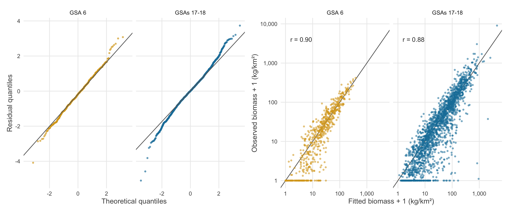{width="74%" fig-align="center"}

:::: {.columns}
::: {.column width="50%"}
- Both models **converge** (all `sanity()` checks passed)
- Residuals on the normal line: **Tweedie** fits zeros and large catches
:::
::: {.column width="50%"}
- Observed vs fitted (log): **r = `r num(k$grp_cor[["GSA 6"]], 0.01)`** (GSA 6), **`r num(k$grp_cor[["GSAs 17-18"]], 0.01)`** (Adriatic)
- In-sample fit; **cross-validation** would test new hauls
:::
::::

## Bottom temperature: two areas compared

:::: {.columns}
::: {.column width="58%"}
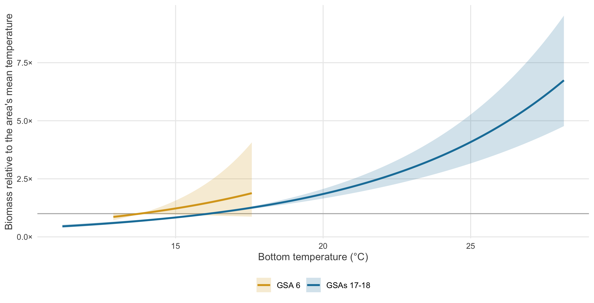{width="100%"}
:::
::: {.column width="42%"}
[`r pcs(k$grp_temp$per_c[2])`]{.big-number}
[biomass per +1 °C in the Adriatic (95% CI `r pcs(k$grp_temp$lo[2])` to `r pcs(k$grp_temp$hi[2])`)]{.big-label}

[`r pcs(k$grp_temp$per_c[1])`]{.big-number}
[per +1 °C in GSA 6 (95% CI `r pcs(k$grp_temp$lo[1])` to `r pcs(k$grp_temp$hi[1])`): not significant]{.big-label}

::: {.caveat}
**Discussion point:** GSA 6 hauls span only `r sprintf("%.1f-%.1f", k$grp_temp$sbt_min[1], k$grp_temp$sbt_max[1])` °C (Adriatic `r sprintf("%.1f-%.1f", k$grp_temp$sbt_min[2], k$grp_temp$sbt_max[2])` °C), so the temperature effect is poorly constrained there and depth dominates.
:::
:::
::::

## Predicted biomass: GSA 6

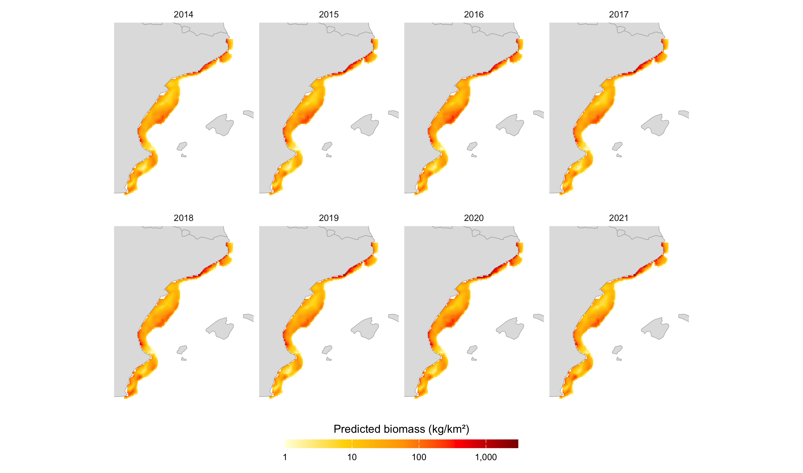{width="78%" fig-align="center"}

[Highest on the inner shelf along the whole coast, dropping quickly offshore.]{.small .muted}

## Predicted biomass: Adriatic

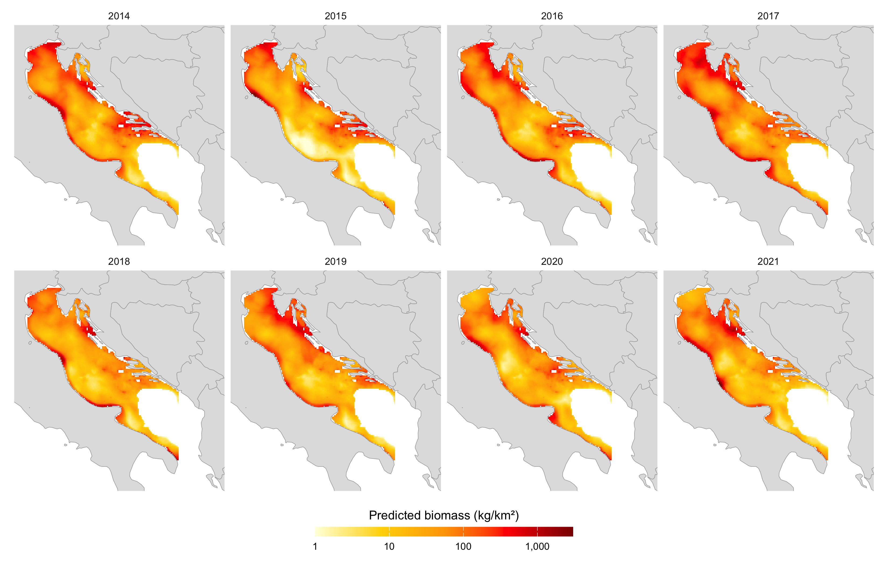{width="74%" fig-align="center"}

[Highest in the shallow northern basin and along the Croatian coast; a gentler depth gradient over a much wider shelf.]{.small .muted}

## Spatial and spatio-temporal random effects

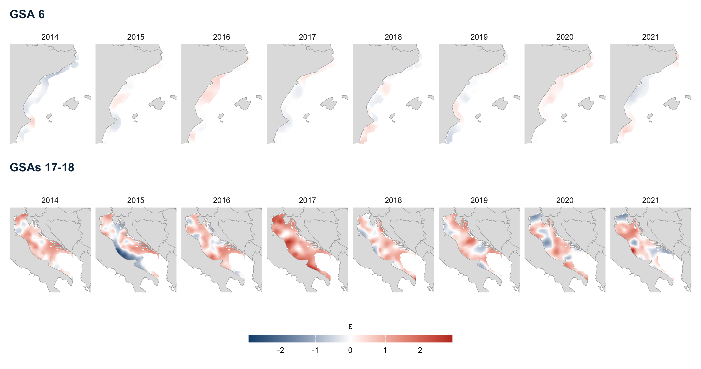{width="100%" fig-align="center"}

:::: {.columns}
::: {.column width="50%"}
**ω** (first column): persistent hotspots not explained by depth and temperature
:::
::: {.column width="50%"}
**ε** by year: small in GSA 6, large in the Adriatic (up to ±`r num(k$grp_eps_max[["GSAs 17-18"]], 0.1)`, a factor of ~`r round(exp(k$grp_eps_max[["GSAs 17-18"]]))` in biomass)
:::
::::

## Biomass index

:::: {.columns}
::: {.column width="58%"}
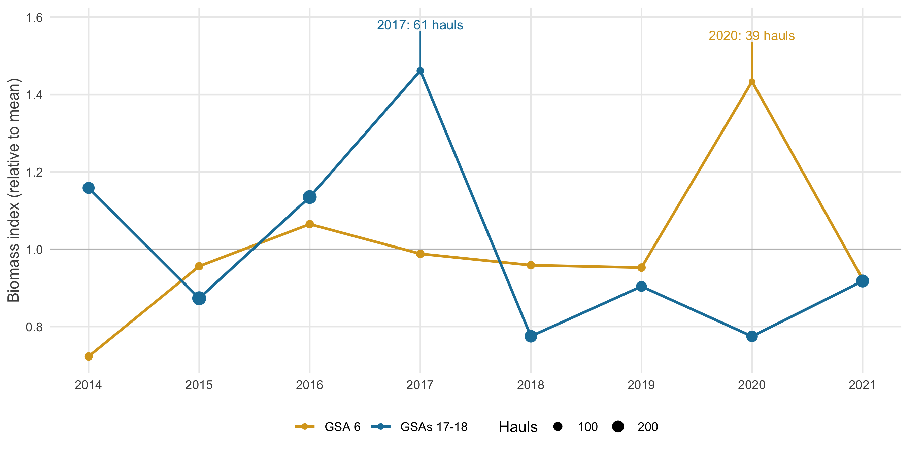{width="100%"}
:::
::: {.column width="42%"}
Sum of predicted biomass × cell area, per year

[`r pcs(k$grp_idx_6_change)`]{.big-number}
[GSA 6, 2015 → 2021 (Tweedie GAM of Section 2b: `r pcs(k$grp_gam_change / 100)` in density)]{.big-label}

[`r pc(k$grp_idx_1718_rng[1])` to `r pc(k$grp_idx_1718_rng[2])`]{.big-number}
[The Adriatic index fluctuates more, between `r pc(k$grp_idx_1718_rng[1])` and `r pc(k$grp_idx_1718_rng[2])` of its 2014-2021 mean]{.big-label}

::: {.caveat}
**Discussion point:** each area peaks in its **least-sampled year**. Index standard errors (`get_index()`) would show how uncertain these years are.
:::
:::
::::

## Habitat suitability index (HSI)

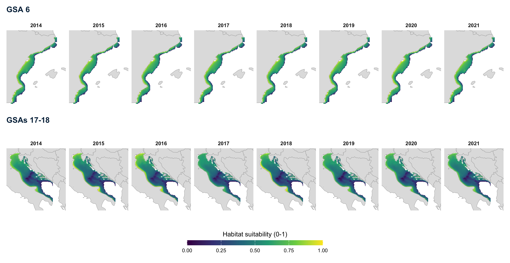{width="100%" fig-align="center"}

[Fixed effects (depth + bottom temperature) rescaled to 0-1 across all years in each area; reproduces the group's maps. Highest on the shallow inner shelf; in the Adriatic, the northern basin scores high almost everywhere.]{.small .muted}

## Change in habitat suitability, 2014 to 2021

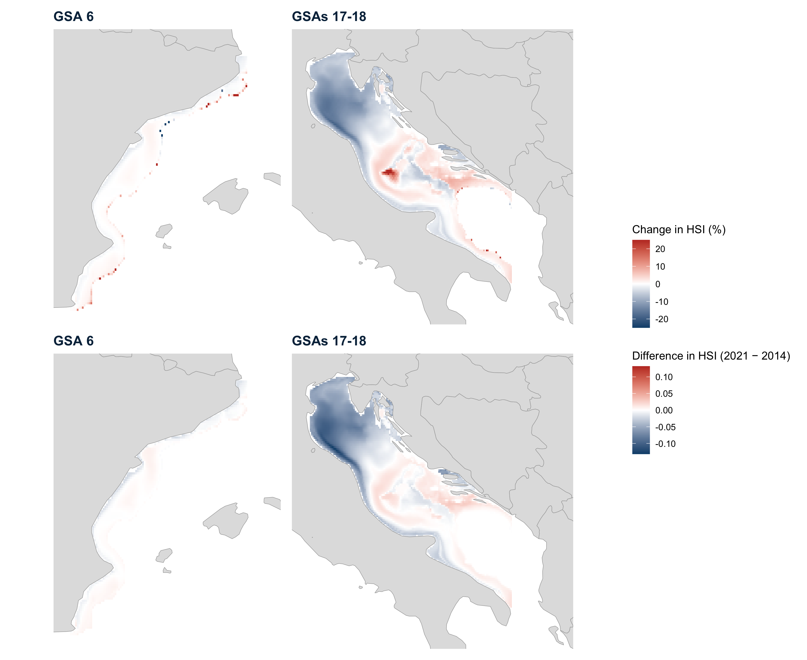{width="80%" fig-align="center"}

:::: {.columns}
::: {.column width="50%"}
- GSA 6: median **`r pcs(k$grp_perc_med[["GSA 6"]] / 100, 0.1)`**, almost no change
- Adriatic: median **`r pcs(k$grp_perc_med[["GSAs 17-18"]] / 100, 0.1)`**; `r pc(k$grp_hsi_lower[["GSAs 17-18"]])` of cells lose suitability, mainly the northern basin
:::
::: {.column width="50%"}
::: {.caveat}
**Discussion point:** the % change of a 0-1 index explodes where HSI ≈ 0 (up to `r pcs(k$grp_perc_max_6 / 100)` in one GSA 6 cell): use the **difference in HSI** and a **2014-2021 trend** rather than two years.
:::
:::
::::

## Overlap between red mullet and trawling

:::: {.columns}
::: {.column width="55%"}
{width="86%" fig-align="center"}
:::
::: {.column width="45%"}
Local correlation between red mullet and **GFW trawling effort**, by year

- **Red**: trawling concentrated where red mullet is abundant
- GSA 6: mostly negative, positive patches on the outer shelf
- Adriatic: a positive band through the north-western and central basin every year; coastal edge negative

::: {.caveat}
**Discussion point:** in small windows, correlations near ±1 are common by chance: add a **significance test** or a **whole-area overlap measure**.
:::
:::
::::

## Marine heatwaves in the two areas

:::: {.columns}
::: {.column width="62%"}
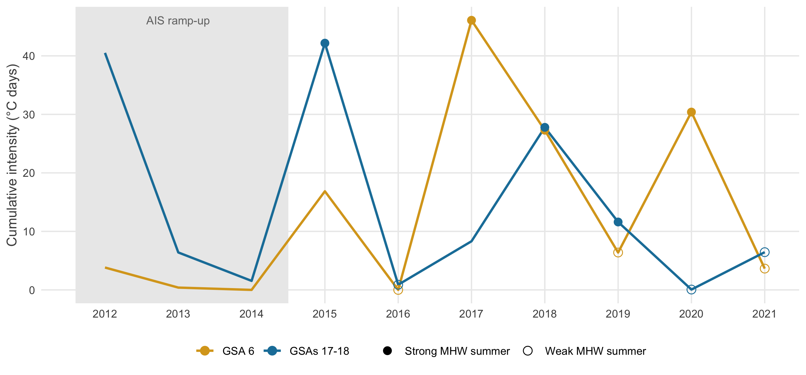{width="100%"}
:::
::: {.column width="38%"}
Summer heatwaves (Hobday et al. 2016) computed on the prediction grid of each area

- **GSA 6** strongest summers: **`r paste(sort(subset(k$grp_mhw_pick, region == "GSA 6" & class == "Strong MHW summer")$YEAR), collapse = ", ")`**
- **Adriatic** strongest summers: **`r paste(sort(subset(k$grp_mhw_pick, region == "GSAs 17-18" & class == "Strong MHW summer")$YEAR), collapse = ", ")`**

::: {.caveat}
**Discussion point:** the two areas do not share their heatwave years (2020: strong in GSA 6, almost none in the Adriatic), so comparisons need area-specific years.
:::
:::
::::

## Heatwaves, biomass trends and trawling trends: GSA 6

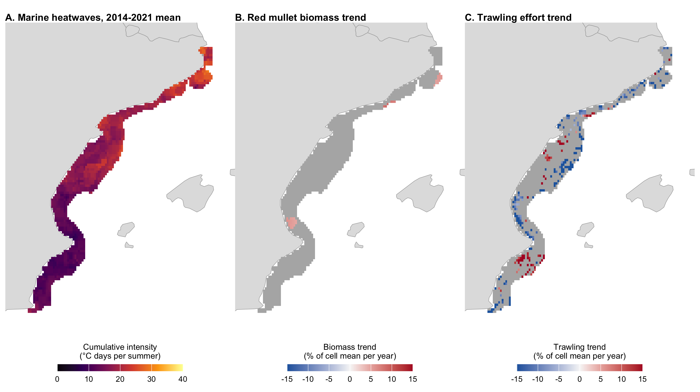{width="80%" fig-align="center"}

[Trends 2014-2021 per cell, as % of the cell's mean per year; grey: not significant (p ≥ 0.05). Significant biomass trends: `r scales::percent(subset(k$grp_trend_sig, region == "GSA 6")$bio, 1)` of cells; none after correcting for multiple tests.]{.small .muted}

## Heatwaves, biomass trends and trawling trends: Adriatic

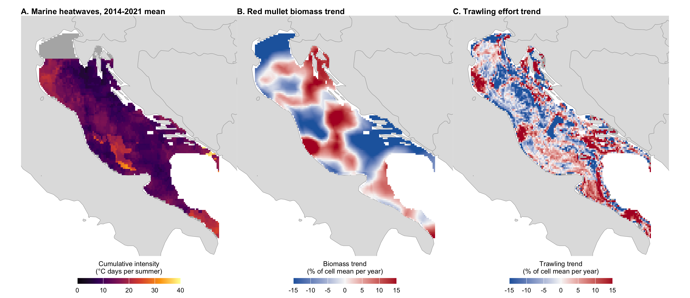{width="86%" fig-align="center"}

[Grey in A: no SST data north of 45°N. Significant biomass trends: `r scales::percent(subset(k$grp_trend_sig, region == "GSAs 17-18")$bio, 1)` of cells; none after correcting for multiple tests.]{.small .muted}

## Trawling in strong and weak heatwave summers

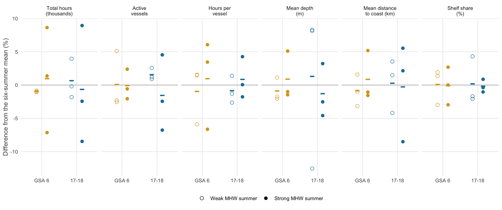{width="80%" fig-align="center"}

:::: {.columns}
::: {.column width="50%"}
- Daily GFW trawler effort, June-August, 3 strong vs 3 weak summers, **from 2015**
:::
::: {.column width="50%"}
- Total hours: **`r subset(k$grp_fleet_tab, Area == "GSA 6" & Metric == "Total hours (thousands)")$Difference`** in GSA 6, **`r subset(k$grp_fleet_tab, Area == "GSAs 17-18" & Metric == "Total hours (thousands)")$Difference`** in the Adriatic, within year-to-year noise
:::
::::

## Do the fleets fish the same grounds?

:::: {.columns}
::: {.column width="56%"}
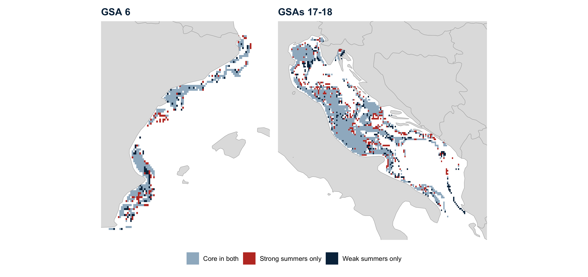{width="100%"}

[Core grounds (cells with 80% of hours): blue-grey in both types of summer, red strong only, dark blue weak only.]{.small .muted}
:::
::: {.column width="44%"}
::: {.small}
| | GSA 6 | Adriatic |
|---|---|---|
| Overlap D, strong vs weak | `r subset(k$grp_overlap_tab, Area == "GSA 6" & Pair == "Strong vs weak")[["Schoener's D"]]` | `r subset(k$grp_overlap_tab, Area == "GSAs 17-18" & Pair == "Strong vs weak")[["Schoener's D"]]` |
| Overlap D, same type | `r paste(subset(k$grp_overlap_tab, Area == "GSA 6" & Pair != "Strong vs weak")[["Schoener's D"]], collapse = ", ")` | `r paste(subset(k$grp_overlap_tab, Area == "GSAs 17-18" & Pair != "Strong vs weak")[["Schoener's D"]], collapse = ", ")` |
| Centre shift | `r subset(k$grp_overlap_tab, Area == "GSA 6" & Pair == "Strong vs weak")[["Centre-of-gravity shift (km)"]]` km | `r subset(k$grp_overlap_tab, Area == "GSAs 17-18" & Pair == "Strong vs weak")[["Centre-of-gravity shift (km)"]]` km |
| Effort on red mullet hotspots | `r with(subset(k$grp_hab, region == "GSA 6"), paste(scales::percent(hot[class == "strong"], 1), "/", scales::percent(hot[class == "weak"], 1)))` | `r with(subset(k$grp_hab, region == "GSAs 17-18"), paste(scales::percent(hot[class == "strong"], 1), "/", scales::percent(hot[class == "weak"], 1)))` |
:::

**Same grounds** in strong and weak heatwave summers: overlap as high as between two summers of the same type (D: 1 = identical effort distribution).
:::
::::

## Heatwaves and red mullet biomass across years

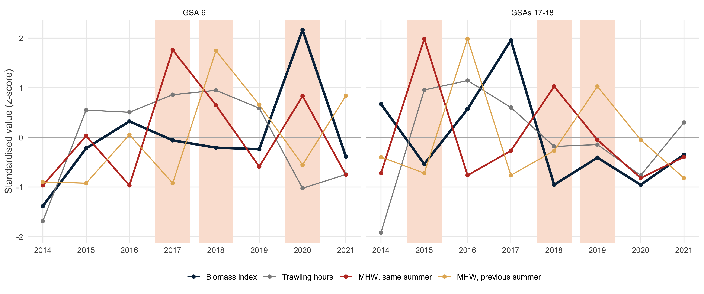{width="72%" fig-align="center"}

:::: {.columns}
::: {.column width="34%" .small}
**Adriatic:** biomass drops in the two strongest heatwave summers (2015, 2018), recovers the year after; overall ρ = `r round(subset(k$grp_annual_cor, region == "GSAs 17-18")$same, 2)`
:::
::: {.column width="30%" .small}
**GSA 6:** the opposite, its strongest heatwave summers are among its higher-biomass years (ρ = `r round(subset(k$grp_annual_cor, region == "GSA 6")$same, 2)`)
:::
::: {.column width="36%"}
::: {.caveat}
**Discussion point:** eight years per area, two areas in opposite directions: a hypothesis to test, not a result.
:::
:::
::::

## Heatwaves and red mullet biomass within years

:::: {.columns}
::: {.column width="64%"}
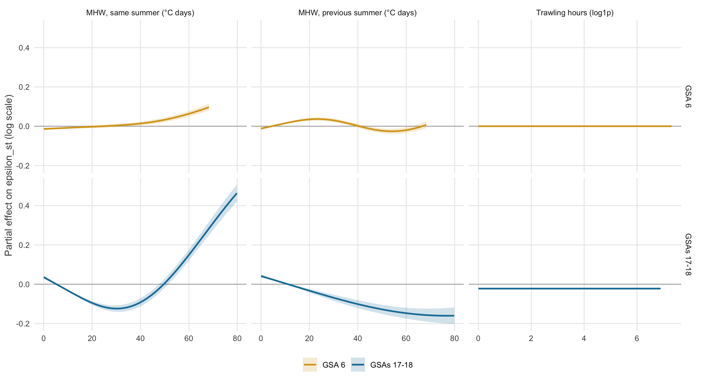{width="100%"}
:::
::: {.column width="36%"}
Year-specific deviation of predicted biomass (ε) in each cell, against heatwaves and trawling, with depth, latitude and year in the model

- **GSA 6:** small effects
- **Adriatic:** not monotonic, a dip at moderate heat, higher biomass in the hottest cells
- **No trawling effect** in either area
- Does not reproduce the annual dips
:::
::::

## Next steps

- Index **standard errors** with `get_index()`, especially for the thinly sampled years
- **Cross-validation** to test predictive skill
- Add an **intercept or year effects** to the model formula
- Habitat change as an **HSI difference or 2014-2021 trend**, rather than % change between two years
- Overlap with trawling: **significance** and a single summary per area and year
- Heatwaves: compare effort on **heatwave days vs other days** of the same summers; add heatwave intensity or a **bottom temperature anomaly** as a covariate of the model

## Slides, report and code {.center}

:::: {.columns}
::: {.column width="34%"}
**These slides**

[theophilemt92.github.io/gfw-med-data-lab/<br>climate-env-ais/Quarto_slides_2C_red_mullet.html](https://theophilemt92.github.io/gfw-med-data-lab/climate-env-ais/Quarto_slides_2C_red_mullet.html){.small}
:::
::: {.column width="34%"}
**Full report** (Section 2c)

[theophilemt92.github.io/gfw-med-data-lab/<br>climate-env-ais/Quarto_report_CLIMATE-ENV-AIS.html](https://theophilemt92.github.io/gfw-med-data-lab/climate-env-ais/Quarto_report_CLIMATE-ENV-AIS.html#c.-red-mullet-the-groups-spatio-temporal-model-gsa-6-and-adriatic){.small}
:::
::: {.column width="32%"}
**Code**

[github.com/TheophileMt92/<br>gfw-med-data-lab](https://github.com/TheophileMt92/gfw-med-data-lab/tree/main/climate-env-ais){.small}
:::
::::

<span class="small muted">MEDITS from JRC; environment from Copernicus Marine; trawling effort from Global Fishing Watch. Figures and numbers from the report rendered `r k$rendered`.</span>
