```{r setup}
#| include: false
# All figures and numbers come from the report: its last chunk writes
# outputs/report_numbers.rds and copies its figures to figures/.
# If the report source is newer than those (or they are missing), the report is
# re-rendered first, so rendering these slides always reflects the latest report.
report <- "Quarto_report_CLIMATE-ENV-AIS.qmd"
nums   <- "outputs/report_numbers.rds"
if (!file.exists(nums) || file.mtime(report) > file.mtime(nums)) {
  message("Report changed: re-rendering ", report, " first")
  status <- system2("quarto", c("render", shQuote(report)))
  if (status != 0) stop("Report render failed; slides not updated")
}
k <- readRDS(nums)
pc  <- function(x, acc = 1) scales::percent(x, accuracy = acc)
pcs <- function(x, acc = 1) sub("^-", "−", scales::percent(x / 100, accuracy = acc, style_positive = "plus"))
num <- function(x, acc = 1) scales::comma(x, accuracy = acc)
pv  <- function(p) format.pval(p, digits = 1, eps = 1e-4)
mhw_top <- sort(k$mhw_cum, decreasing = TRUE)
mhw_zero <- names(k$mhw_cum)[k$mhw_cum == 0]
```

## Data

:::: {.columns}
::: {.column width="62%"}
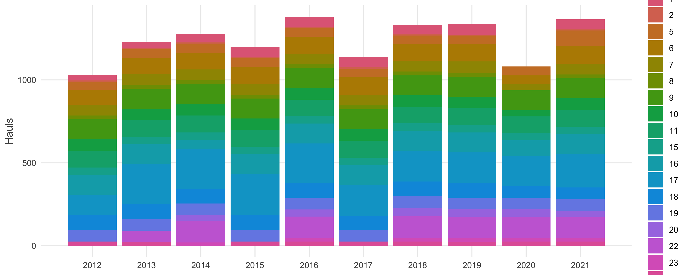{width="100%"}
:::
::: {.column width="38%"}
- **MEDITS** bottom-trawl survey, 2012-2021: abundance per species and haul
- **Copernicus Marine** reanalyses at each haul: bottom temperature, salinity, chlorophyll
- **GFW AIS** apparent fishing hours, trawlers, yearly 0.1° cells, pulled with `gfwr`
- Focus on **GSA 6** (Spanish Mediterranean, Murcia to the French border)

<span class="small muted">`r num(k$n_hauls_all)` hauls in `r k$n_gsa` GSAs; `r num(k$n_hauls_gsa6)` in GSA 6</span>
:::
::::

## AIS coverage changes over time

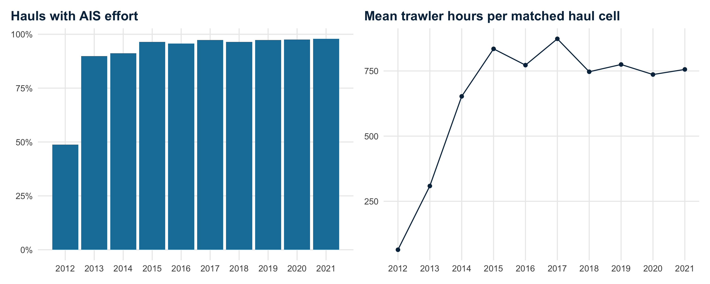{width="82%" fig-align="center"}

:::: {.columns}
::: {.column width="33%"}
[`r pc(k$ais_match_2012)` → `r pc(k$ais_match_2021)`]{.big-number}
[hauls with matched AIS effort, 2012 → 2021]{.big-label}
:::
::: {.column width="33%"}
[`r num(k$ais_hours_2012)` → `r num(k$ais_hours_2015)` h]{.big-number}
[mean effort at matched hauls, 2012 → 2015]{.big-label}
:::
::: {.column width="34%"}
::: {.caveat}
The 2012-2014 rise reflects **AIS adoption**, not more fishing. Comparisons spanning these years partly measure AIS uptake: start in 2015 or use effort per vessel.
:::
:::
::::

## Total fish abundance: species distribution model

:::: {.columns}
::: {.column width="58%"}
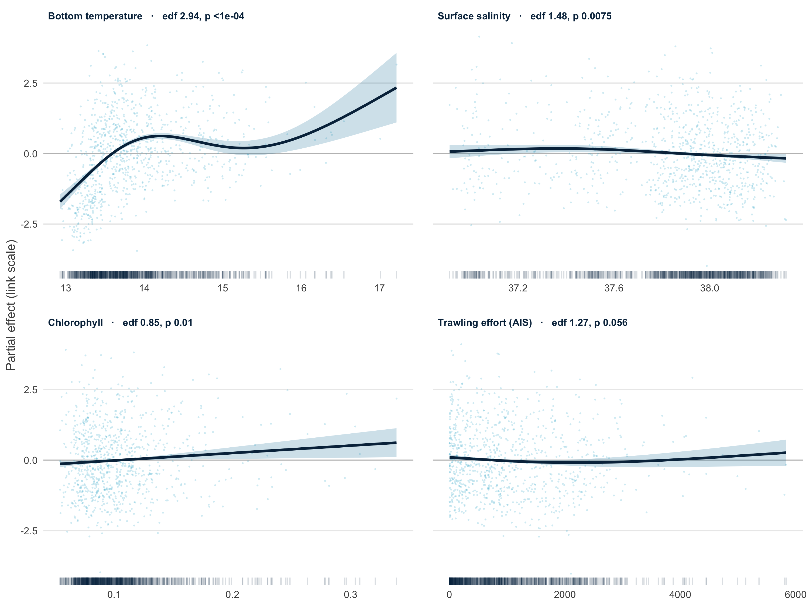{width="100%"}
:::
::: {.column width="42%"}
- Gaussian GAM on **log total fish abundance**, GSA 6, n = `r num(k$gam2_n)` hauls
- Bottom temperature carries most of the signal; fishing hours only marginal (p = `r pv(k$gam2_p_fishing)`)
- About **`r pc(k$gam2_dev)`** of deviance explained
- SST smooth already shrunk to zero by `select = TRUE`

::: {.caveat}
**Log scale:** predictions are log(N/km²), so the group's % change was computed on logs. Back-transformed, the median cell changes by **`r pcs(k$tf_change_bt)`**, not `r pcs(k$tf_change_log)`, from 2012 to 2021.
:::
:::
::::

## Red mullet: species distribution model

:::: {.columns}
::: {.column width="52%"}
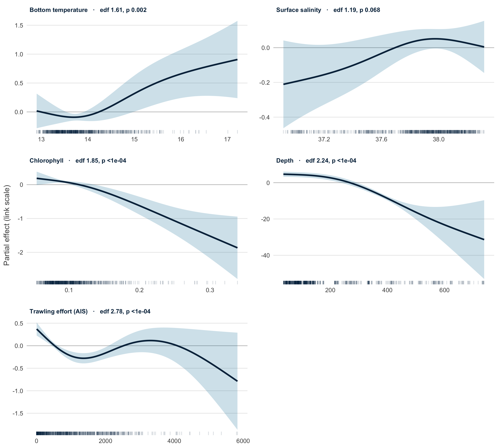{width="100%"}
:::
::: {.column width="48%"}
*Mullus barbatus* (`MULLBAR`), the group's focal species

- **Zeros kept:** caught in `r num(k$mb_present)` of `r num(k$mb_hauls)` GSA 6 hauls (`r pc(k$mb_present / k$mb_hauls)`)
- **Tweedie GAM** (log link): handles zeros and skewed catches, predicts N/km² directly
- **Depth added:** deviance explained **`r pc(k$mb_dev_env)` → `r pc(k$mb_dev_depth)`**, AIC −`r num(k$mb_aic_drop)`
- Density high to ~200 m, then falls steeply; ↑ with bottom temperature, ↓ with chlorophyll

::: {.caveat}
The fishing-hours smooth peaks at zero effort: likely **confounding** (trawlers target mullet grounds), so treated as a nuisance covariate.
:::
:::
::::

## Red mullet: habitat change 2015-2021

:::: {.columns}
::: {.column width="55%"}
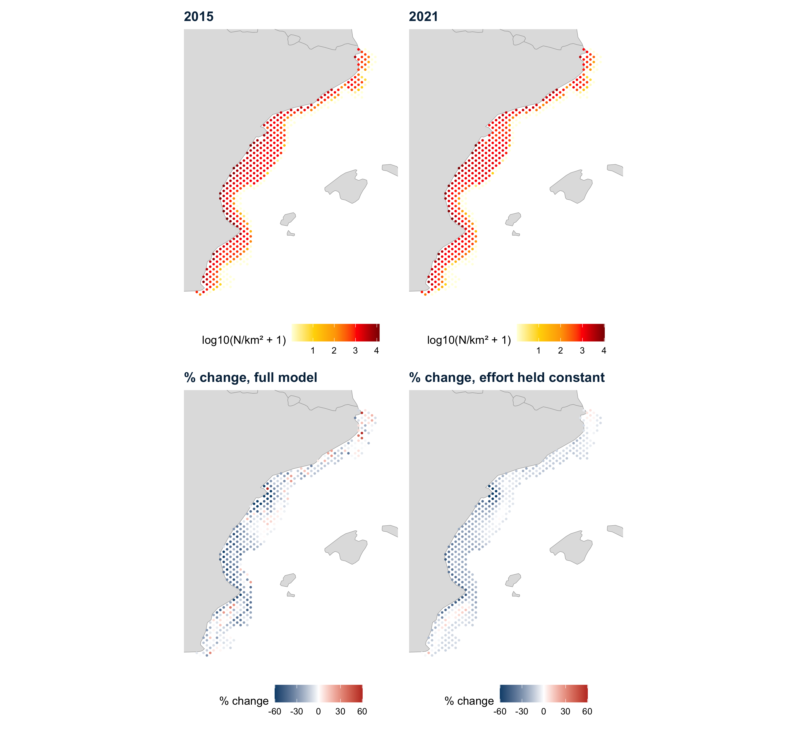{width="100%"}
:::
::: {.column width="45%"}
June predictions on the Copernicus hindcast grid, within the sampled depth range; change computed after the AIS ramp-up

[`r pcs(k$mb_change_env)`]{.big-number}
[median change per cell with effort held constant (`r pcs(k$mb_change_full)` with the full model)]{.big-label}

[`r pc(k$mb_decline_env)`]{.big-number}
[of `r num(k$mb_cells)` cells decline with effort held constant (range `r pcs(k$mb_min_env)` to `r pcs(k$mb_max_env)`)]{.big-label}

::: {.caveat}
Mean bottom temperature is similar in 2015 and 2021, so the decline is **not simply warming**. Driver not yet identified.
:::
:::
::::

## Marine heatwaves and fleet behaviour

:::: {.columns}
::: {.column width="50%"}
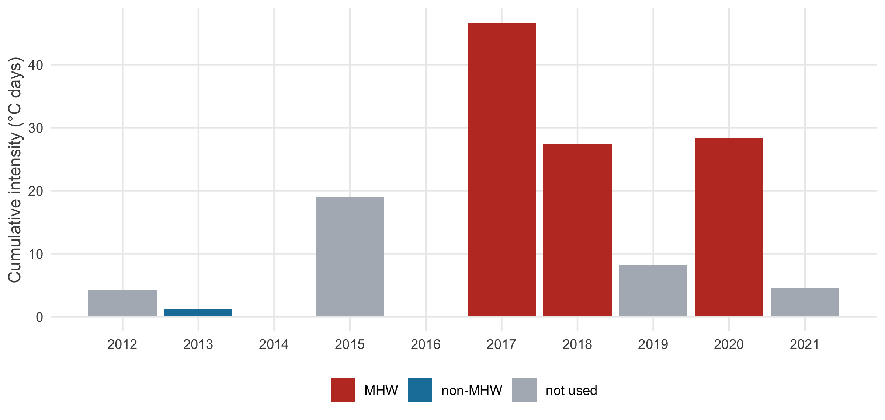{width="100%"}

- Hobday et al. (2016) detection with `heatwaveR`, summer events only
- Strongest summers: **`r names(mhw_top)[1]`** (`r num(mhw_top[1], 0.1)` °C·days), `r names(mhw_top)[2]`, `r names(mhw_top)[3]`; none in `r paste(mhw_zero, collapse = " and ")`
:::
::: {.column width="50%"}
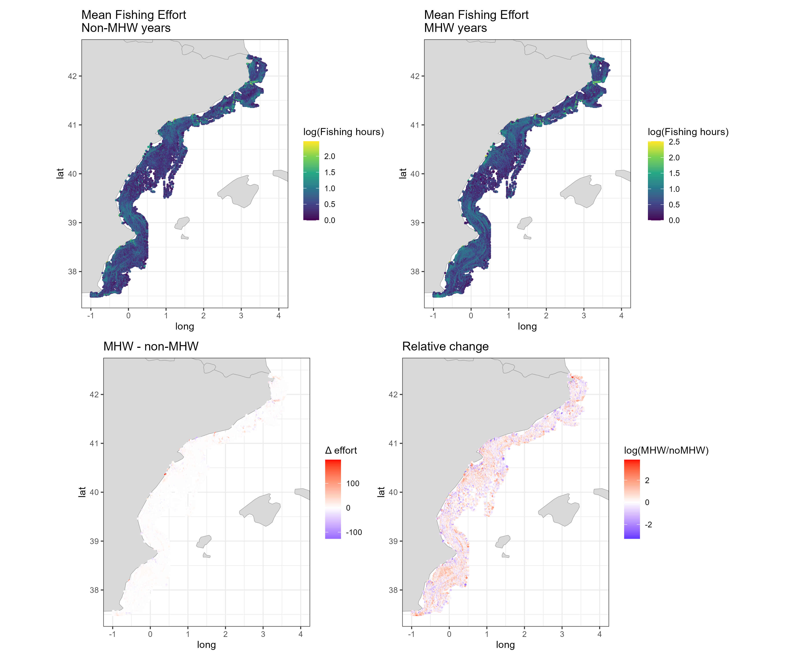{width="78%" fig-align="center"}

::: {.caveat}
`r pc(k$fleet_more_mhw)` of cells show more trawling in heatwave summers, but non-heatwave years include **low-AIS 2013-2014**. Contrast 2016 vs 2017 instead.
:::
:::
::::

## Climate-fisheries vulnerability index

:::: {.columns}
::: {.column width="52%"}
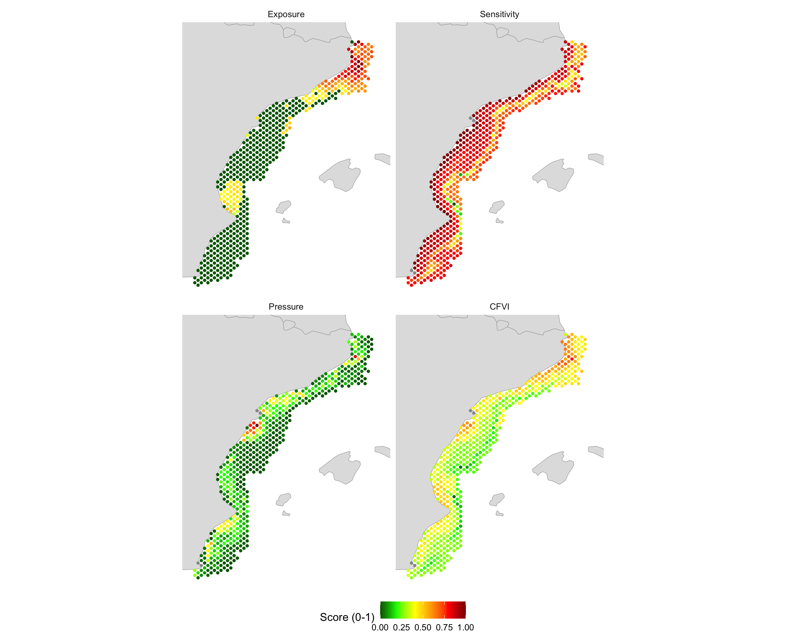{width="100%"}
:::
::: {.column width="48%"}
Mean of three 0-1 scores: **heatwave exposure + habitat loss + fishing pressure**

- Hotspots off Cap de Creus-Roses and nearshore off the Ebro and Valencia

::: {.caveat}
- Exposure from 2021 only: **`r pc(k$cfvi_exp_zero)`** of cells score exactly 0
- Pressure very skewed: median score `r num(k$cfvi_press_med, 0.01)`
- Sensitivity inherits the log-scale issue

**Better:** 2015-2021 mean exposure, log effort, back-transformed change, test the weights
:::
:::
::::

## Next steps

:::: {.columns}
::: {.column width="50%"}
**Fix in the existing pipeline**

1. **AIS ramp-up:** start in 2015 or normalise effort per vessel
2. **Log scale:** back-transform before computing change
3. **Zeros:** same treatment of unmatched effort in fitting, prediction and averaging
4. **Index design:** align time windows, test transformation and weights
:::
::: {.column width="50%"}
**Red mullet**

- Identify which environmental term drives the 2015-2021 decline
- Check it against the observed MEDITS trend
- Feed red mullet habitat change into the vulnerability index in place of total fish
:::
::::

## Slides, report and code {.center}

:::: {.columns}
::: {.column width="34%"}
**These slides**

[theophilemt92.github.io/gfw-med-data-lab/<br>climate-env-ais/Quarto_slides_CLIMATE-ENV-AIS.html](https://theophilemt92.github.io/gfw-med-data-lab/climate-env-ais/Quarto_slides_CLIMATE-ENV-AIS.html){.small}
:::
::: {.column width="34%"}
**Full report** (code, tables, diagnostics)

[theophilemt92.github.io/gfw-med-data-lab/<br>climate-env-ais/Quarto_report_CLIMATE-ENV-AIS.html](https://theophilemt92.github.io/gfw-med-data-lab/climate-env-ais/Quarto_report_CLIMATE-ENV-AIS.html){.small}
:::
::: {.column width="32%"}
**Code**

[github.com/TheophileMt92/<br>gfw-med-data-lab](https://github.com/TheophileMt92/gfw-med-data-lab/tree/main/climate-env-ais){.small}
:::
::::

<span class="small muted">All GFW data via `gfwr`; MEDITS from JRC; environment from Copernicus Marine. Figures and numbers from the report rendered `r k$rendered`.</span>

## Backup {.section-break background-color="#062d4a"}

Collinearity and model diagnostics

## Collinearity among predictors

:::: {.columns}
::: {.column width="52%"}
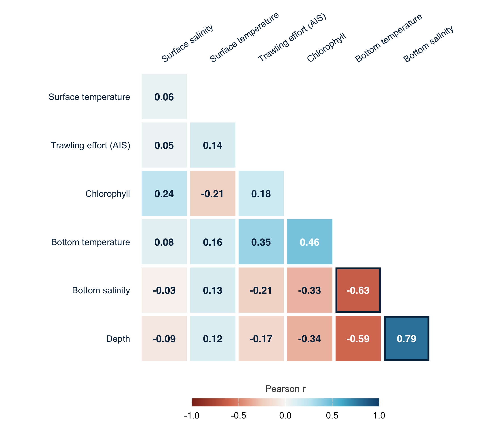{width="86%"}

[Total fish model: bottom salinity dropped (VIF `r num(k$botso_vif, 0.1)`; r = `r num(k$r_botso_depth, 0.01)` with depth)]{.small .muted}
:::
::: {.column width="48%"}
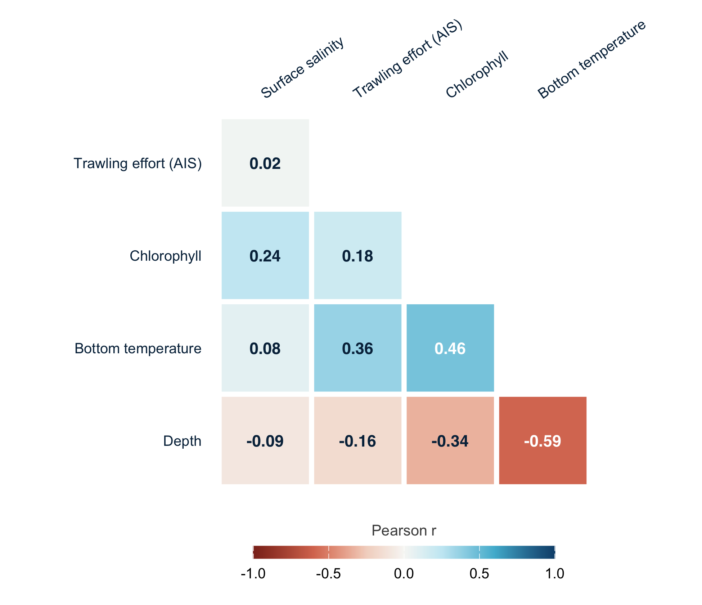{width="92%"}

[Red mullet model: all VIF ≤ `r num(k$mb_vif_max, 0.1)`]{.small .muted}
:::
::::

## Residual diagnostics

:::: {.columns}
::: {.column width="50%"}
**Total fish** (Gaussian, standardised residuals)

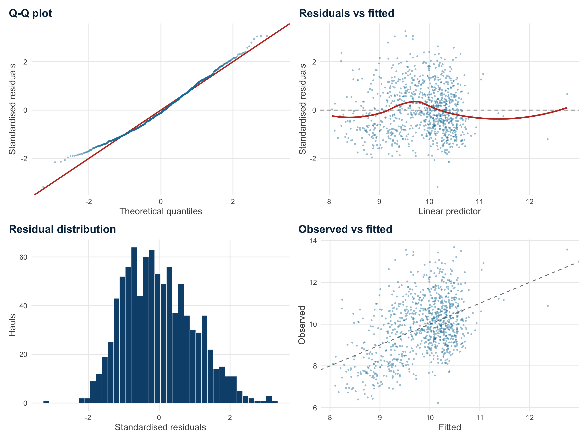{width="88%"}

[k-index ≈ 1 for all terms (all p ≥ `r num(k$kcheck_min_p, 0.01)`)]{.small .muted}
:::
::: {.column width="50%"}
**Red mullet** (Tweedie, simulated quantile residuals)

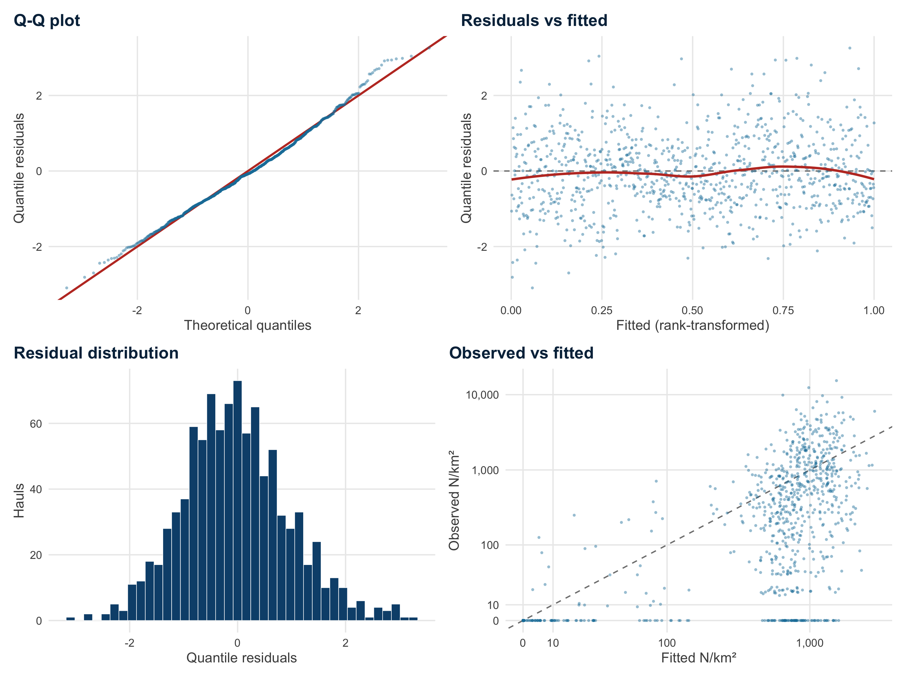{width="88%"}

[Good overall fit; zero-catch hauls often predicted at several hundred N/km²]{.small .muted}
:::
::::

## Red mullet and depth

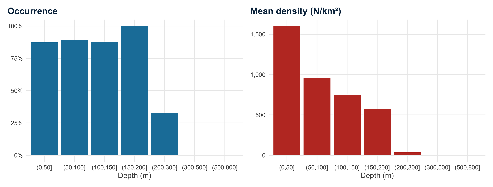{width="100%"}

[Occurrence and mean density by haul depth, GSA 6 MEDITS hauls 2012-2021]{.small .muted}
